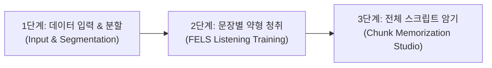

# PRODUCT.md - CE Tool 제품 전략 및 핵심 가치 정의서

## 1. 제품 개요 (Product Overview)
**CE Tool (Chunk & FELS Weak-Form Listening Trainer)** 은 영어 청취 및 청크 발화 집중 훈련을 위한 독립형(Zero-CORS, Standalone) 웹 애플리케이션입니다.

- **핵심 목표**: 원어민의 빠른 연음, 기능어 약형(Weak forms - Pronoun, Preposition, Auxiliary 등) 및 청크 단위 발화 구조를 체계적으로 듣고 따라 말하며 완벽히 체화하도록 돕는 3단계 집중 학습 시스템 제공.
- **아키텍처 특징**: 외부 서버나 무거운 번들러 의존성 없이, 브라우저 로컬 Web Audio API(PCM 파형 분석, VAD 묵음 감지)와 로컬 스토리지 기반으로 100% 동작.

---

## 2. 타깃 사용자 페르소나 (Target Personas)
1. **수능 / 토익 / 영어 회화 학습자**:
   - 연음 및 약형 소리를 듣지 못해 전체 문장을 놓치는 학습자.
   - 단어 단위가 아닌 의미 청크 단위로 빠르게 직독직해하고 발화하고자 하는 학습자.
2. **영어 교사 및 강사 (Educators)**:
   - 교실 수업용 대형 프로젝터 화면을 통해 학생들과 함께 청크 훈련을 진행하려는 교사.
   - 수업용 A4 양면 유인물(앞면: FELS 빈칸 약형드랩 / 뒷면: 직독직해 청크 해석)을 1초 만에 인쇄 및 배포하고자 하는 강사.

---

## 3. 핵심 3단계 학습 워크플로우 (3-Stage Workflow)

1. **1단계 (데이터 입력 및 세그멘테이션)**:
   - MP3 음성 파일 및 영문 스크립트 입력.
   - 브라우저 Web Audio API 기반 VAD(Voice Activity Detection) 묵음 탐지 및 문장 경계 자동 분할.
   - FELS 알고리즘을 통한 기능어 약형 태깅 및 청크 자동 분할.
2. **2단계 (문장별 FELS 약형 청취 집중 훈련)**:
   - 문장 단위 구간 무한 루핑(Looper) 및 단축키 재생 조작.
   - 3D 플립 청크 카드를 통한 앞면(영어 빈칸/원문) ⇄ 뒷면(해석) 인터랙션.
   - 빈칸 채점 및 약형 발음 팁 실시간 피드백.
3. **3단계 (전체 스크립트 청크 암기 스튜디오)**:
   - 지문 전체의 청크를 한눈에 조망하며 전체 듣기 및 빈칸 가리기(Cloze) 모드.
   - 교실 프로젝터용 대형 화면(Classroom Mode) 및 A4 양면 유인물 인쇄 출력.

---

## 4. 제품 디자인 및 인터랙션 원칙 (Design Principles)
- **High Legibility First**: 11px 미만의 마이크로 텍스트를 배제하고, WCAG 2.1 AA 기준(4.5:1 이상 명도 대비)을 철저히 준수.
- **Natural Physics Motion**: 인위적이고 산만한 바운스 효과를 지양하고 자연스러운 감속 곡선(`cubic-bezier(0.16, 1, 0.3, 1)`)과 부드러운 마이크로 트랜지션 적용.
- **Quiet Depth over Loud Slop**: 인공적인 네온 발광이나 과도한 그라데이션 대신, 정돈된 중립 입체 섀도우와 절제된 1px 서브틀 보더를 사용하여 전문적인 학습 도구의 신뢰감 부여.
- **Keyboard-Driven Velocity**: 단축키(`Space`, `[`, `]`, `\`, `F5~F11`, `S`, `T`)만으로 마우스 없이 오디오 루핑과 카드 뒤집기 완결 가능.
