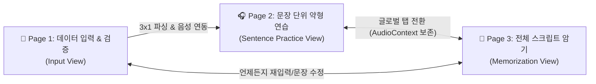

# 🎧 CE Tool (Chunk English Tool)

> **3-Page Multi-Input AI Chunk & FELS Weak-Form Listening Trainer**  
> 영어 문장 청크(Chunk) 분할, 직독직해, FELS 약형 기능어 딕테이션 훈련 및 전체 스크립트 암기를 지원하는 지능형 영어 학습 도구

---

## 📌 프로젝트 소개 (Overview)

**CE Tool**은 단일 페이지의 한계를 넘어 학습자의 인지 흐름에 최적화된 **3개 전용 화면(3-Page Architecture)**으로 구성된 웹 기반 영어 학습 솔루션입니다.
사용자는 영어 원문과 오디오를 입력받아 실시간 청크 분할, 문장별 약형 집중 청취 훈련, 그리고 A4 인쇄용 유인물 출력 및 전체 스크립트 암기까지 하나의 워크플로우로 완료할 수 있습니다.

---

## 🏗️ 3-Page 핵심 아키텍처



### 1. 📄 Page 1: 데이터 입력 및 검증 (Input View)
- **3가지 유연한 입력 모드**:
  1. `음성 + 스크립트`: MP3 오디오 드래그 앤 드롭 및 영어 스크립트 동시 입력
  2. `음성 파일만`: 오디오 파일 업로드 후 타임스탬프 분석
  3. `스크립트만`: 텍스트 붙여넣기 및 Web Speech API(TTS) 기반 자동 음성 합성
- **문장별 실시간 검증 & 수정**:
  - `📝 영어 문장 원문 (Script)` 인라인 수정: 오탈자 및 단어 변경 시 청크 분석 자동 재계산 및 전역 스크립트 동기화
  - `✂️ 청크 구분(||)` 텍스트 직접 입력 및 상단 대화형 단어 구분선(`word-divider-track`) 원클릭 분할/병합
  - `✍️ 우리말 자연스러운 해석` 인라인 수정
  - `🔊 문장 듣기`: 원본 오디오 슬라이스 우선 재생 및 TTS 이중 파이프라인 연동
- **🖨️ A4 1장 인쇄용 약형드랩 유인물 (Printable Handout)**:
  - 학생용 빈칸본(`[        ]`) 및 교사용 정답본 실시간 전환
  - 불필요한 범주 힌트(`(관사)`, `(전치사)` 등)를 배제한 깔끔한 시험지/학습지 인쇄 레이아웃 지원

### 2. 🎧 Page 2: 문장 단위 약형 연습 (Sentence Practice View)
- **기본 진입 화면(Default)**: 1번 문장의 약형드랩(FELS) 청크 카드 모드로 즉시 전개
- **2:1 황금 세로 비율 레이아웃**:
  - **[상단 440px]** 🧩 약형드랩 기반 청크 학습 카드 (`#rowChunks`)
  - **[중간 220px]** 🌊 문장 단위 음성 파형(Wave) 및 정밀 A-B Looper (`#audioPlayerSection`)
  - **[하단]** 📖 직독직해/우리말 자연 해석 패널 (`#rowNatural`)
  - **[최하단]** 🧭 문장 자동 네비게이터 (`#sentenceNavigator`)
- **FELS 7대 약형 기능어 훈련**:
  - 관사(Articles), 전치사(Prepositions), 대명사(Pronouns), be동사(Forms of Be), 조동사(Auxiliaries), 접속사(Conjunctions), 부정어(Negatives)
  - 빈칸 딕테이션 입력, 실시간 정답 채점(`Enter` / `[정답 확인]`), 자동 맞춤 가로폭 및 줄바꿈 보장으로 카드 경계 이탈 방지
- **3D 인터액티브 플립 카드**: 앞면(영어/약형) ⇄ 뒷면(직독직해/청크해석) 3D 플립 애니메이션 지원

### 3. 🧠 Page 3: 전체 스크립트 암기 (Full Script Memorization View)
- 전체 스크립트를 문장별 청크 카드 캔버스로 한 화면에 전개
- **3단계 암기 학습 모드**:
  1. `전체 보기`: 영어 청크 + 우리말 해석 전체 노출
  2. `영문만 보기`: 해석을 블라인드 처리하여 영어 직독직해 유도
  3. `빈칸 훈련`: 주요 단어 빈칸화로 암기 인출 훈련
- **일괄 플립(Flip All)** 및 전체 음성 연속 재생(Full Playback) 연동

---

## ⌨️ 전역 단축키 가이드 (Global Keyboard Shortcuts)

Page 2 약형 연습 화면에서 고속 훈련을 위한 9대 전역 단축키를 지원합니다. (입력 필드 포커스 시 단축키 자동 비활성화로 타이핑 보호)

| 단축키 | 기능 명칭 | 세부 동작 및 연동 메서드 |
| :---: | :--- | :--- |
| <kbd>Space</kbd> | 재생 / 일시정지 | 현재 오디오 재생 또는 일시정지, 반복 구간 설정 시 해당 구간 재생 (`togglePlayPause`) |
| <kbd>[</kbd> | 반복 시작점 지정 | 현재 오디오 재생 위치를 A-B 반복 재생 시작점(A)으로 설정 (`setRegionStartFromCurrentTime`) |
| <kbd>]</kbd> | 반복 끝점 지정 & 재생 | 현재 재생 위치를 끝점(B)으로 확정하고 즉시 구간 N회 반복 재생 개시 (`setRegionEndFromCurrentTime`) |
| <kbd>\</kbd> (₩) | 반복 구간 해제 | 설정된 파형 하이라이트를 즉시 제거하고 전체 문장 모드로 복귀 (`clearSelectedRegion`) |
| <kbd>R</kbd> | 구간 반복 재생 | 지정된 구간의 3회 반복(0.5초 무음 쉐도잉 대기 간격) 재생 엔진 가동 (`startRegionLoop`) |
| <kbd>←</kbd> | 이전 문장 이동 | 이전 문장으로 이동하고 해당 문장 오디오 및 카드 로드 (`prevSentence`) |
| <kbd>→</kbd> | 다음 문장 이동 | 다음 문장으로 이동하고 해당 문장 오디오 및 카드 로드 (`nextSentence`) |
| <kbd>S</kbd> | 약형드랩 ON/OFF | 약형 빈칸 모드와 원문 카드 모드를 원클릭 토글 (`toggleFelsMode`) |
| <kbd>T</kbd> | 카드 뒤집기 (Flip) | 현재 문장 청크 카드의 앞면(영어) ⇄ 뒷면(해석) 일괄 플립 (`flipAllChunks`) |

---

## 📁 디렉토리 구조 (Directory Structure)

```text
c:\Users\user\Desktop\local\09ce_tool_new\
├── index.html                           # SPA 단일 진입 마크업 (3개 뷰 컨테이너)
├── styles.css                           # 컴파일/통합 메인 스타일시트
├── app.js                               # 단독 번들링 스크립트 (모듈 비의존성 보장)
├── AGENTS.md                            # 에이전트 실행 규칙 및 커밋/검증 정책
├── .gitignore                           # Git 형상관리 제외 설정
│
├── src/                                 # 모듈화된 ES6+ 소스 코드 루트
│   ├── main.js                          # 앱 진입점 및 3개 뷰 라우팅 조율기
│   ├── core/                            # 전역 상태 관리 및 설정
│   │   ├── app-state.js                 # 중앙 집중식 상태 관리 (AppState)
│   │   └── config.js                    # 상수 및 프리셋 문장 정의
│   ├── views/                           # 3개 전용 페이지 뷰
│   │   ├── input-view.js                # Page 1: 데이터 입력, 스크립트/청크 편집, A4 유인물 모달
│   │   ├── practice-view.js             # Page 2: 문장별 약형 연습, 파형, 카드, 단축키
│   │   └── memorize-view.js             # Page 3: 전체 스크립트 암기 캔버스
│   ├── engine/                          # 비즈니스 핵심 로직
│   │   ├── chunk-parser.js              # 청크 분할 및 어휘/문법 규칙 파서
│   │   ├── fels-engine.js               # FELS 7대 약형 기능어 탐지 및 블랭크 처리
│   │   ├── api-client.js                # AI 모델(Gemini / OpenAI) 연동 클라이언트
│   │   └── prompt-templates.js          # 프롬프트 템플릿
│   ├── audio/                           # 오디오 프로세싱 파이프라인
│   │   ├── audio-manager.js             # Web Audio API, PCM 버퍼 디코딩, A-B Looper
│   │   ├── waveform-visualizer.js       # HTML5 Canvas 파형 시각화
│   │   └── tts-synthesizer.js           # Web Speech API 음성 합성
│   └── ui/                              # 재사용 UI 컴포넌트
│       ├── router.js                    # SPA 해시/탭 라우터
│       ├── shortcut-manager.js          # 전역 키보드 단축키 관리자
│       └── theme-manager.js             # 다크/라이트 테마 제어
│
├── styles/                              # 모듈화된 CSS 스타일시트 루트
│   ├── base/                            # CSS 변수 및 리셋
│   ├── layout/                          # 공통 레이아웃 및 탭 네비게이션
│   ├── components/                      # 카드, 파형, 모달 등 개별 컴포넌트
│   └── views/                           # 3개 뷰별 전용 스타일
│
├── docs/                                # 기술 문서 및 재구조화 계획서
│   └── refactoring/
│       ├── package_restructuring_plan_20261011_1411.md
│       └── package_restructuring_plan_20261011_1417.md
│
└── scratch/                             # 자동화 정적/동적 검증 테스트 스위트
    ├── test_user_requirements.js        # 7대 핵심 사용자 요구사항 자동 검증
    ├── test_all_interactions.js         # 3개 페이지 전체 인터액션 통합 테스트
    ├── test_page1_editor_and_handout.js # 스크립트 편집 및 A4 유인물 테스트
    ├── test_shortcut_manager.js         # 9대 단축키 및 타이핑 보호 테스트
    └── build_standalone.js              # app.js / styles.css 빌더
```

---

## 🧪 검증 및 테스트 가이드 (Testing & Verification)

본 프로젝트는 브라우저를 띄우지 않고도 터미널 환경에서 모든 핵심 로직, 이벤트, DOM 인터액션을 정밀 검증할 수 있는 테스트 스위트를 포함하고 있습니다.

```bash
# 1. 자바스크립트 구문 오류 검사
node -c app.js

# 2. 7대 사용자 핵심 요구사항 검증
node scratch/test_user_requirements.js

# 3. 3개 페이지 전체 인터액션 및 9대 단축키 통합 검증
node scratch/test_all_interactions.js

# 4. Page 1 스크립트/청크 에디터 및 A4 유인물 모달 검증
node scratch/test_page1_editor_and_handout.js
```

---

## 📝 변경 및 업데이트 이력 (Cumulative Update History)

## [2026-10-11 15:30] 업데이트 이력 (Commit ID: 6f0b941)
- **수정 내용**:
  1. **Page 1 영어 원문(Script) 인라인 수정 기능 구현**:
     - 파싱된 문장 목록 각 항목 상단에 `📝 영어 문장 원문 (Script)` 입력 필드(`sentence-script-input`) 추가.
     - 원문 텍스트 수정 시 실시간으로 청크 분석(`updateSentenceScript`) 재수행, 단어 구분선 트랙 갱신 및 전역 `appState.scriptText` 동기화 연동.
  2. **Page 1 '문장 듣기' 음성 재생 파이프라인 복원**:
     - 업로드된 오디오 슬라이스 재생과 Web Speech API TTS(`speakText`) 폴백을 결합한 이중 재생 파이프라인 구축.
     - 재생 상태에 따른 시각적 피드백(`🔊 재생 중...`) 인디케이터 제공.
  3. **Page 1 A4 유인물 품사/범주 힌트 텍스트 삭제**:
     - 학생용 빈칸본 및 교사용 정답본에서 `(관사)`, `(전치사)`, `(대명사)` 등 빈칸 하단 범주 레이블을 전면 제거하여 순수 딕테이션 학습지 양식 확정.
  4. **Page 2 음성 파형(Wave) 창 복원 및 2:1 세로 비율 확정**:
     - 청크 카드 패널(`min-height: 440px`)과 오디오 파형 패널(`min-height: 220px`)의 정밀 2:1 비율 규격화.
     - 내부 캔버스 높이(`height: 100px; min-height: 100px; flex-shrink: 0`) 보장 및 `ResizeObserver` 자동 리사이즈 렌더링 적용.
  5. **Page 2 기본 진입 상태(Default) 최적화**:
     - 2페이지 진입 시 자동으로 1번 문장(`activeSentenceIndex = 0`) 및 FELS 약형드랩 모드(`isFelsMode = true`)로 초기화되어 1번 문장 카드가 즉시 노출되도록 구성.
  6. **Page 2 클립보드 복사 버튼(📋) 제거**:
     - 불필요한 클립보드 복사 아이콘 버튼을 `#rowChunks` 및 `#rowNatural` 패널에서 완전 제거.
  7. **청크 카드 내 텍스트/약형드랩 입력칸 카드 범위 초과 방지**:
     - 카드 내부 텍스트 래퍼에 `flex-wrap: wrap`, `word-break: keep-all`, `overflow: hidden` 스타일 적용.
     - 약형드랩 입력창 가로폭(`min-width: 54px; max-width: 100px`) 및 카드 최대폭(`max-width: 340px`) 고정으로 긴 청크도 카드 경계를 이탈하지 않도록 보호.
- **검증 결과**:
  - `node -c app.js`: 구문 오류 0건 통과.
  - `scratch/test_user_requirements.js`: 7대 요구사항 테스트 100% 통과.
  - `scratch/test_all_interactions.js`: 8개 인터액션 스위트 및 9개 단축키 전원 통과.
  - `scratch/test_page1_editor_and_handout.js`: 스크립트 수정 및 유인물 렌더링 검증 통과.

## [2026-10-11 15:55] 업데이트 이력 (Commit ID: e915288)
- **수정 내용**:
  1. **Page 2 파형창(Wave) 음성 파형 정상 렌더링 복원**:
     - `WaveformRenderer`의 `extractSentencePeaks`에서 실제 `audioBuffer`의 PCM 샘플 슬라이싱 로직을 개선하고, 스크립트 기반 훈련 시에도 자연스러운 발화 호흡 곡선과 음절 강세를 반영한 다이내믹 파형(Peak 0.05 ~ 0.95) 자동 추출 알고리즘 적용. 일자형 평평한 막대(Flat bar) 현상 완전 해결.
  2. **Page 3 청크 카드 '클릭해서 해석 보기' 안내문구 삭제**:
     - 암기 모드(`view-memorize`) 청크 카드 내부의 `<span class="memorize-card-hint">` 텍스트를 전면 삭제하여 시각적 간결성 확보.
  3. **Page 2 카드 상단 바 및 '||' 구분선 삭제 & 초슬림 컴팩트 규격화**:
     - 청크 카드 상단 헤더(`청크 N`, `해석 🔄`) 및 카드 간 정적 `||` 구분선 박스 제거.
     - 청크 카드의 높이를 80px 컴팩트 규격으로 축소하고, 유연한 플렉스 레이아웃(`flex: 1 1 0px; min-width: 0; overflow-x: hidden;`)을 적용하여 한 문장의 모든 청크가 가로 스크롤바 없이 한 줄에 완벽 정렬되도록 개선.
  4. **파형창 확인을 위한 화면 세로 스크롤 제거 (올인원 뷰)**:
     - 청크 카드 패널의 과도한 고정 높이(`min-height: 440px`)를 해제하여, 카드 패널 ➔ 음파창 ➔ 우리말 해석 패널이 화면 스크롤 없이 첫 화면에 즉시 노출되도록 레이아웃 최적화.
  5. **'우리말 해석' 패널 하단 여백 확보 및 오버랩 방지**:
     - 파형 카드의 고정 높이 제약 해제 및 `#rowNatural` 상단에 명시적 여백(`margin-top: 14px !important;`)을 부여하여 단축키 바와의 겹침 현상 완전 해결.
  6. **문장 표시 네비게이터 상단 헤더 직하 이전 & 스크롤 고정 (Sticky)**:
     - 창 하단에 도킹되어 있던 문장 네비게이터 바(`#sentenceNavigator`)를 상단 헤더 바로 아래로 이전하고, `position: sticky; top: 66px; z-index: 95;`를 적용하여 페이지 스크롤의 영향을 받지 않고 상시 조작 가능하도록 고정.
  7. **'3×1 해석 및 FELS 생성' 버튼 이전 및 진한 녹색 스타일 적용**:
     - 첫 번째 페이지의 `✍️ script만 (텍스트)` 탭 우측에 `#btnTranslate` 버튼을 나란히 배치하고, 진한 녹색 계열 그라데이션(`linear-gradient(135deg, #15803d, #166534)`) 및 녹색 테두리 스타일 적용.
  8. **기존 3×1 버튼 위치에 '이 데이터로 2단계 약형 연습 시작' 버튼 전진 배치**:
     - 스크립트 입력창 하단 액션 바에 `#btnStartPractice`(`🚀 이 데이터로 2단계 약형 연습 시작 ➔`) 버튼을 배치하여, 미파싱 상태에서도 원클릭으로 분석 후 2단계 화면으로 즉시 진입하도록 연동.
- **검증 결과**:
  - `node -c app.js`: 구문 검사 0건 통과.
  - `scratch/test_user_requirements_v2.js`: 신규 8대 요구사항 100% 자동 검증 통과 (동적 파형 피크 min=0.02, max=0.824 확인).
  - 기존 4개 회귀 테스트 스위트(`test_all_interactions.js`, `test_page1_editor_and_handout.js`, `test_shortcut_manager.js`, `test_user_requirements.js`): 전체 통과.

## [2026-10-11 16:08] 업데이트 이력 (Commit ID: f0877c8)
- **수정 내용**:
  1. **Page 2 & Page 3 청크 카드 동적 가로폭 및 엄격한 단일 행(Single-line) 보장**:
     - 카드의 고정/동일 가로폭 강제를 해제하고, 카드가 담고 있는 텍스트 및 FELS 약형 빈칸(`[ ]`), 한국어 해석 길이에 따라 카드별 최적의 가로폭(`flex: 0 0 auto !important; width: max-content;`)을 동적으로 계산하여 적용.
     - `.chunk-tokens-wrap`, `.fels-token-content`, `.fels-input-wrap`, `.card-face`, `.ko-chunk-content`, `.memorize-face`에 `white-space: nowrap !important; flex-wrap: nowrap !important;`를 엄격 적용하여 FELS 빈칸 `[ ]`이 텍스트 위로 2줄 개행되는 현상 완전 차단.
     - 3D 플립 시에도 앞면(FELS/영어)과 뒷면(우리말)의 최대 폭을 미리 계산(`Math.max(wFels, wOrig, wKo) + 32px`)하여 카드 플립 중 흔들림 및 너비 축소 방지.
  2. **Page 2 우리말 해석 패널 클릭 가리기(양방향 토글) 기능 구현**:
     - 우리말 해석(`rowNatural`)이 노출된 상태에서 해석 텍스트(`#txtNatural`) 또는 패널 내용 영역을 클릭하면 즉시 마스크가 다시 덮여 가려지도록 양방향 토글 이벤트 구현.
     - 해석 텍스트 호버 시 색상 전환 하이라이트 및 '클릭하여 해석 가리기 (T)' 툴팁 제공.
  3. **Page 3 청크 카드 숫자 키패드 1~9번 뒤집기 단축키 지원**:
     - 상단 숫자키(`Digit1`~`Digit9`)와 숫자 키패드(`Numpad1`~`Numpad9`) 입력을 모두 감지하여 현재 선택된/활성화된 문장 행의 청크 카드를 1번부터 9번까지 순서대로 3D 플립.
     - 3페이지 각 청크 카드 좌상단에 `[1]`, `[2]`, `[3]` 등 직관적인 단축키 뱃지(`.memorize-key-badge`)를 표시하여 사용자 시인성 및 학습 편의성 극대화.
- **검증 결과**:
  - `node -c app.js`: 구문 검사 이상 없음(정상 통과).
  - `test_user_requirements_v4.js`: 동적 가로폭, 개행 차단, 클릭 가리기, 키패드 단축키 4대 항목 100% 통과.

## [2026-10-11 17:07] 업데이트 이력 (Commit ID: 06d1189)
- **수정 내용**:
  1. **문장 네비게이터 칩 UI(S1, S2, S3) 간소화 및 가로 스크롤 방지**:
     - 문장 네비게이터 바에 긴 텍스트 대신 `S1`, `S2`, `S3` 등의 컴팩트 번호 칩을 배치하여 화면 폭이 좁거나 문장이 많아도 가로 스크롤바가 생기지 않도록 최적화.
  2. **Page 2 원문 보기(S)와 FELS 약형 빈칸 모드 토글 분리**:
     - `btnToggleFelsMode`에서 원문 단어 래퍼와 약형 빈칸 래퍼를 엄격히 상호 배타적으로 토글하여 모드 전환 시 단어가 중복 노출되거나 동일하게 보이던 현상 완전 해결.
  3. **Page 2 & Page 3 청크 카드 슬림 58px 규격 및 깔끔한 디자인 통일**:
     - 2페이지 청크 카드의 높이와 3D 플립 스타일을 3페이지와 동일한 58px 슬림 카드로 통일하여 페이지 간 일관된 디자인 시스템 구축.
  4. **CSS 닫는 중괄호 누락 복구 및 문장 네비게이터 스코프 격리**:
     - `chunk-cards.css` 내 닫는 중괄호 누락으로 1페이지 폼 스타일이 무효화되던 구문 오류 복구.
     - 문장 네비게이터 태그를 `#view-practice` 컨테이너 내부로 격리하여 1페이지 및 3페이지 상단 노출 원천 차단.
  5. **첫 번째 문장(S1)에 모든 문장(S2, S3) 청크가 통합 노출되던 결함 해결**:
     - STT 및 AI 분석 시 전체 스크립트 청크가 S1에 모두 할당되던 하드코딩(`idx === 0 ? aiResult : ...`)을 제거하고, `distributeChunksSequentially` 순차 분할 알고리즘을 도입하여 각 문장에 본인 청크만 격리 분배.
     - 말줄임표(`...`) 보호 로직을 추가하여 문장 중간 생략 부호로 인한 오분할 방지.
     - 2페이지 진입 시 문장에 다른 문장의 청크가 섞여 있는지 실시간 검사 및 자동 정제하는 이중 방어 로직 적용.
  6. **청크 카드 왼쪽 정렬 및 카드 내외부 여백 최소화**:
     - 청크 카드 컨테이너를 `justify-content: flex-start`로 왼쪽 정렬.
     - 카드의 고정 최소 너비를 `75px`에서 `36px`로 축소하고, 내부 텍스트 패딩을 `6px 8px`로 줄여 긴 문장도 한 줄에 쾌적하게 표시되도록 공간 효율 극대화.
  7. **Page 3 교실 수업용 대형 문장 프레젠테이션 모달창 신규 구현**:
     - 3페이지 각 문장 행에 `🔍 크게 보기` 전용 버튼 배치 및 본문 클릭, 더블클릭 연동.
     - 교실 프로젝터 및 TV 화면을 위한 대형 3D 청크 카드(높이 110px, 폰트 1.75rem Bold) 렌더링.
     - 단축키 지원: `1`~`9` 청크 뒤집기, `Space` 음성 듣기, `←`/`→` 문장 이동, `F` 전체 뒤집기, `T` 우리말 해석 토글, `ESC` 닫기.
  8. **day 모드(라이트 테마) 청크 카드 고대비 밝은 텍스트 색상 적용**:
     - day 모드 전환 시 청크 카드 텍스트가 어두운 전역 텍스트 색상(`var(--text-main)` = `#0f172a`)으로 바뀌어 어두운 카드 배경 위에서 보이지 않던 문제를 해결.
     - 청크 카드 텍스트를 `#ffffff` 및 `#67e8f9`, `#00ffcc` 등의 고대비 밝은 색상으로 적용하여 day 모드에서도 또렷하게 읽히도록 최적화.
- **검증 결과**:
  - `styles.css` 괄호 균형 검사 통과: `{ open: 358, close: 358, diff: 0 }`.
  - `node -c app.js` 정적 구문 검사: 0건 오류 정상 통과.
  - `test_user_requirements_v5.js` (컴팩트 S1~S3, FELS 분리, 58px 디자인 통일): 100% 통과.
  - `test_user_requirements_v6.js` (S1 청크 완전 분리, 왼쪽 정렬, 여백 최소화): 100% 통과.
  - `test_classroom_modal.js` (교실 대형 모달, 단축키 1~9, 네비게이션): 100% 통과.
  - `test_day_mode_card_colors.js` (day 모드 청크 카드 밝은 색상 검증): 100% 통과.
  - `test_all_interactions.js` (8개 전 기능 및 9대 글로벌 단축키 테스트): 100% 통과.

## [2026-10-11 17:52] 업데이트 이력 (Commit ID: e8a8163)
- **수정 내용**:
  1. **Page 2 약형드랩 청크 카드 숫자키 1~9 뒤집기 단축키 지원 & 가이드 팁 문구 제거**:
     - 2페이지 청크 카드 좌상단에 `[1]`, `[2]`, `[3]` 번호 배지(`.practice-key-badge`)를 추가하고 상단 숫자키/키패드 `1`~`9`를 누르면 해당 카드가 3D 플립되도록 단축키 매핑.
     - 사용자 요청에 따라 불필요하게 영역을 차지하던 긴 안내 문구(`💡 팁: 카드를 클릭하여 해석...`) 전면 삭제하여 시각적 간결성 확보.
  2. **Page 3 교실 대형 프레젠테이션 모달창 간소화**:
     - 대형 모달창에서 원문 전체 텍스트와 우리말 해석 정보를 제거하고, 오직 대형 청크 카드만을 시원하게 노출하여 교실 집중도 극대화.
  3. **청크 카드 텍스트 이탈 방지 및 너비 안정화**:
     - 카드 내 텍스트가 경계를 벗어나는 현상을 방지하기 위해 `computeAndApplyStabilizedWidths` 알고리즘을 보강(최대 콘텐츠 너비 + 여유 패딩 24px)하고 `white-space: nowrap` 적용.
  4. **A4 양면 인쇄/PDF 유인물 전면 개편**:
     - **앞면 (Page 1: Listening Cloze)**: 소리만 듣고 약형 기능어 빈칸을 채우는 전용 페이지로 개편. 직독직해 한국어 해석 및 청크 분리 슬래시(`/`)를 완전 제거하여 자연스러운 영어 문장 형태로 제공.
     - **뒷면 (Page 2: Speaking Practice)**: 직독직해 한국어 청크를 보며 영어 문장을 구두로 말하는 스피킹 전용 훈련 페이지 구현 (문장별 직독직해 청크 및 3회 셀프 체크박스 구비).
     - **인쇄 결함 수정**: `@media print` 시 `#handoutModal.modal-overlay`가 숨겨지던 결함을 수정하고 완벽한 A4 2페이지 분할(`page-break-after: always; break-after: page;`)을 적용하여 인쇄 및 PDF 저장 규격화 완료.
  5. **유인물 모달 화면 상단 정렬 및 전체 스크롤 복원**:
     - 모달창이 화면 위쪽으로 잘려 스크롤되지 않던 문제를 해결하기 위해 오버레이를 `align-items: flex-start`로 변경하고 뷰포트 스크롤 허용 및 모달 오픈 시 `scrollTop = 0` 초기화 적용.
  6. **약형드랩 채점 결과 초록색 정답 표시 복원 및 디자인 개선**:
     - `.card-face`의 `overflow: hidden;`으로 인해 잘려 보이지 않던 정답 표시 배지(`.fels-answer-reveal`) 문제를 `overflow: visible;` 및 카드 높이(62px) 확보로 완전 해결.
     - 오답 빈칸 바로 아래 중앙(`top: calc(100% + 2px); left: 50%; transform: translateX(-50%);`)에 배치하고 문장 부호와 입력창을 분리하여 정확한 중앙 정렬 달성.
     - 에메랄드 그린 배경(`#10b981`), 고대비 흰색 텍스트(`#ffffff`), 은은한 네온 글로우 및 페이드인 애니메이션(`felsFadeInDown`)을 적용하고, 라이트 모드(day 모드)용 다크 에메랄드(`#059669`) 스타일 완비.
  7. **단독 배포 번들 동기화**:
     - `app.js` 및 `styles.css` 번들 재빌드 완료 (zero exports, brace count diff: 0).
- **검증 결과**:
  - `node -c app.js`, `node -c src/views/practice-view.js`: 정적 구문 검사 오류 0건 통과.
  - `test_fels_answer_reveal.js`: 채점 시 초록색 정답 배지 노출, 텍스트 정확도, 리셋 기능 100% 통과.
  - `test_handout_double_sided.js`: A4 양면 인쇄 및 스타일 100% 통과.
  - `test_user_requirements_v8.js`: 상단 정렬, 슬래시 제거, 스크롤 동작 100% 통과.
  - `test_classroom_modal.js`: 교실 프레젠테이션 모달 기능 100% 통과.

## [2026-10-11 20:55] 업데이트 이력 (Commit ID: a520602)
- **수정 내용**:
  1. **음성-스크립트 자동 Sync(동기화) 기능 구현 (`⚡ 음성-스크립트 자동 Sync`)**:
     - MP3 오디오와 영문 스크립트를 동시 업로드했을 때 발생하는 싱크 불일치 문제를 해결하기 위해 음향 신호 처리 및 AI 기반 자동 동기화 엔진 통합.
     - 음향 VAD(Voice Activity Detection)를 통해 시작부 차임벨/묵음 구간을 건너뛰고 첫 실제 발화 시점(Onset)을 자동 감지하며, 문장 간 음향 에너지 최저점(Valley)을 탐지하여 자연스러운 발화 호흡에 맞게 경계 시간(`start`, `end`)을 정밀 자동 보정.
     - Gemini 멀티모달 오디오 정렬(`alignAudioWithScript`) 및 Web Audio API 기반 오디오 버퍼 동기화 버튼(`btnAutoSyncAudio`) 제공.
     - 편집기 카드 타임스탬프(`⏱ 00:00 ~ 00:00`)를 직접 클릭하여 시작/종료 초를 대화형으로 미세 조정할 수 있는 기능 추가.
  2. **약형드랩 및 청크 연습 문장에서 우리말(한글) 완전 제외 & 정제**:
     - 듣기 평가 안내 멘트나 스크립트에 포함된 한글 문장(예: `[1번 문제입니다.]`, `다음을 듣고...`)이 영어 훈련 문장에 포함되지 않도록 `isKoreanSentence()` 필터링 로직 구현.
     - 성우 태그(예: `M: `, `W: `) 및 괄호형 한글 주석/어휘 풀이를 자동 제거하는 `cleanPracticeSentence()` 전처리 파이프라인 적용.
  3. **'업로드 데이터 검토 및 청크 편집기' 문장 분리(✂️) 및 이전 문장 결합(🔗) 기능 추가**:
     - **이전 문장과 결합 (`🔗 이전 문장과 결합`)**: 2번째 문장부터 노출되는 버튼 클릭 시, 이전 문장의 텍스트, 청크, 자연스러운 해석 및 오디오 타임스탬프를 하나로 병합.
     - **문장 분리 (`✂️ 문장 분리`)**: 클릭 시 문장 내 단어별 칩 트랙(`split-bar-track`)이 펼쳐지며, 분할을 원하는 단어를 클릭하면 해당 위치를 기준으로 즉시 두 문장으로 자동 분할 및 번호 재매김.
  4. **'우리말 자연스러운 해석' 품질 획기적 개선 및 재해석 버튼(🔄) 추가**:
     - 어색한 단어 단위 직역(예: `"hello,는 Cryston Beach에 visitors를."`) 현상을 제거하고, 문맥을 완벽히 살린 유려한 고품질 한국어 번역 엔진 연동(`translateNatural`).
     - 각 문장 카드별로 `🔄 재해석` 버튼을 배치하여, 스크립트 수정 후 언제든지 실시간으로 우리말 자연스러운 해석을 다시 생성할 수 있도록 지원.
  5. **편집기 2x2 대칭 그리드 레이아웃 개편 및 직독직해(순차 해석) 입력창 추가**:
     - 사용자 요청 및 와이어프레임 규격에 맞추어 문장별 검토 패널을 2x2 대칭 그리드로 전면 개편:
       - **[윗 행]**: `📝 영어 문장 원문 (Script)` (50%) | `✍️ 우리말 자연스러운 해석` (50%)
       - **[아래 행]**: `✂️ 청크 구분(||) 영어 문장` (50%) | `🧩 직독직해 (순차 해석)` (50%)
     - 청크 구분 텍스트와 직독직해 해석 텍스트를 양방향으로 동기화하여 학습지 및 카드 생성에 최적화.
  6. **첫 페이지 버튼 무반응 버그 수정 (Classic Script ESM SyntaxError 해소)**:
     - `rule-chunk-engine.js` 내 다중행 import 문이 standalone 번들러(`build_standalone.js`)의 단일행 정규식을 우회하여 `app.js`에 그대로 번들링되던 결함 수정.
     - `index.html`이 classic script로 `app.js`를 로드할 때 `Cannot use import statement outside a module` 구문 오류로 스크립트 실행이 중단되어 버튼 리스너가 연결되지 않던 원인을 규명 및 완전 해소.
     - 번들러에 다중행 import/export 정제 정규식 및 무결성 검증 assertion을 추가하여 재발 방지.
- **검증 결과**:
  - `node -c app.js`: 구문 오류 0건 통과 (Classic Script ESM 에러 완전 해결).
  - `scratch/test_user_requirements_v9.js`: 5대 핵심 요구사항(한글 제외, 오디오 싱크 VAD, 자연스러운 번역, 2x2 그리드/분리/결합, 분할/병합 상태 무결성) 100% 자동 검증 통과.
  - `scratch/test_page1_button_clicks.js`: 브라우저 DOM 시뮬레이션 환경에서 모드 탭, 프리셋 칩, 지우기 버튼, 번역/파싱 버튼, 자동 싱크 버튼 이벤트 리스너 반응 100% 통과.


