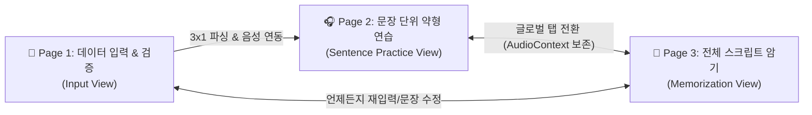

# 🎧 CE Tool (Chunk English Tool)

> **3-Page Multi-Input AI Chunk & FELS Weak-Form Listening Trainer**  
> 영어 문장 청크(Chunk) 분할, 직독직해, FELS 약형 기능어 딕테이션 훈련 및 전체 스크립트 암기를 지원하는 지능형 영어 학습 도구

---

## 📌 프로젝트 소개 (Overview)

**CE Tool**은 단일 페이지의 한계를 넘어 학습자의 인지 흐름에 최적화된 **3개 전용 화면(3-Page Architecture)**으로 구성된 웹 기반 영어 학습 솔루션입니다.
사용자는 영어 원문과 오디오를 입력받아 실시간 청크 분할, 문장별 약형 집중 청취 훈련, 그리고 A4 인쇄용 유인물 출력 및 전체 스크립트 암기까지 하나의 워크플로우로 완료할 수 있습니다.

---

## 🏗️ 3-Page 핵심 아키텍처



### 1. 📄 Page 1: 데이터 입력 및 검증 (Input View)
- **3가지 유연한 입력 모드**:
  1. `음성 + 스크립트`: MP3 오디오 드래그 앤 드롭 및 영어 스크립트 동시 입력
  2. `음성 파일만`: 오디오 파일 업로드 후 타임스탬프 분석
  3. `스크립트만`: 텍스트 붙여넣기 및 Web Speech API(TTS) 기반 자동 음성 합성
- **문장별 실시간 검증 & 수정**:
  - `📝 영어 문장 원문 (Script)` 인라인 수정: 오탈자 및 단어 변경 시 청크 분석 자동 재계산 및 전역 스크립트 동기화
  - `✂️ 청크 구분(||)` 텍스트 직접 입력 및 상단 대화형 단어 구분선(`word-divider-track`) 원클릭 분할/병합
  - `✍️ 우리말 자연스러운 해석` 인라인 수정
  - `🔊 문장 듣기`: 원본 오디오 슬라이스 우선 재생 및 TTS 이중 파이프라인 연동
- **🖨️ A4 1장 인쇄용 약형드랩 유인물 (Printable Handout)**:
  - 학생용 빈칸본(`[        ]`) 및 교사용 정답본 실시간 전환
  - 불필요한 범주 힌트(`(관사)`, `(전치사)` 등)를 배제한 깔끔한 시험지/학습지 인쇄 레이아웃 지원

### 2. 🎧 Page 2: 문장 단위 약형 연습 (Sentence Practice View)
- **기본 진입 화면(Default)**: 1번 문장의 약형드랩(FELS) 청크 카드 모드로 즉시 전개
- **2:1 황금 세로 비율 레이아웃**:
  - **[상단 440px]** 🧩 약형드랩 기반 청크 학습 카드 (`#rowChunks`)
  - **[중간 220px]** 🌊 문장 단위 음성 파형(Wave) 및 정밀 A-B Looper (`#audioPlayerSection`)
  - **[하단]** 📖 직독직해/우리말 자연 해석 패널 (`#rowNatural`)
  - **[최하단]** 🧭 문장 자동 네비게이터 (`#sentenceNavigator`)
- **FELS 7대 약형 기능어 훈련**:
  - 관사(Articles), 전치사(Prepositions), 대명사(Pronouns), be동사(Forms of Be), 조동사(Auxiliaries), 접속사(Conjunctions), 부정어(Negatives)
  - 빈칸 딕테이션 입력, 실시간 정답 채점(`Enter` / `[정답 확인]`), 자동 맞춤 가로폭 및 줄바꿈 보장으로 카드 경계 이탈 방지
- **3D 인터액티브 플립 카드**: 앞면(영어/약형) ⇄ 뒷면(직독직해/청크해석) 3D 플립 애니메이션 지원

### 3. 🧠 Page 3: 전체 스크립트 암기 (Full Script Memorization View)
- 전체 스크립트를 문장별 청크 카드 캔버스로 한 화면에 전개
- **3단계 암기 학습 모드**:
  1. `전체 보기`: 영어 청크 + 우리말 해석 전체 노출
  2. `영문만 보기`: 해석을 블라인드 처리하여 영어 직독직해 유도
  3. `빈칸 훈련`: 주요 단어 빈칸화로 암기 인출 훈련
- **일괄 플립(Flip All)** 및 전체 음성 연속 재생(Full Playback) 연동

---

## ⌨️ 전역 단축키 가이드 (Global Keyboard Shortcuts)

Page 2 약형 연습 화면에서 고속 훈련을 위한 9대 전역 단축키를 지원합니다. (입력 필드 포커스 시 단축키 자동 비활성화로 타이핑 보호)

| 단축키 | 기능 명칭 | 세부 동작 및 연동 메서드 |
| :---: | :--- | :--- |
| <kbd>Space</kbd> | 재생 / 일시정지 | 현재 오디오 재생 또는 일시정지, 반복 구간 설정 시 해당 구간 재생 (`togglePlayPause`) |
| <kbd>[</kbd> | 반복 시작점 지정 | 현재 오디오 재생 위치를 A-B 반복 재생 시작점(A)으로 설정 (`setRegionStartFromCurrentTime`) |
| <kbd>]</kbd> | 반복 끝점 지정 & 재생 | 현재 재생 위치를 끝점(B)으로 확정하고 즉시 구간 N회 반복 재생 개시 (`setRegionEndFromCurrentTime`) |
| <kbd>\</kbd> (₩) | 반복 구간 해제 | 설정된 파형 하이라이트를 즉시 제거하고 전체 문장 모드로 복귀 (`clearSelectedRegion`) |
| <kbd>R</kbd> | 구간 반복 재생 | 지정된 구간의 3회 반복(0.5초 무음 쉐도잉 대기 간격) 재생 엔진 가동 (`startRegionLoop`) |
| <kbd>←</kbd> | 이전 문장 이동 | 이전 문장으로 이동하고 해당 문장 오디오 및 카드 로드 (`prevSentence`) |
| <kbd>→</kbd> | 다음 문장 이동 | 다음 문장으로 이동하고 해당 문장 오디오 및 카드 로드 (`nextSentence`) |
| <kbd>S</kbd> | 약형드랩 ON/OFF | 약형 빈칸 모드와 원문 카드 모드를 원클릭 토글 (`toggleFelsMode`) |
| <kbd>T</kbd> | 카드 뒤집기 (Flip) | 현재 문장 청크 카드의 앞면(영어) ⇄ 뒷면(해석) 일괄 플립 (`flipAllChunks`) |

---

## 📁 디렉토리 구조 (Directory Structure)

```text
09ce_tool_new/
├── index.html                           # SPA 단일 진입 마크업 (3개 뷰 컨테이너) — app.js / styles.css만 로드
├── app.js                               # [빌드 산출물] src/ 단독 번들 (file:// 호환, 직접 수정 금지)
├── styles.css                           # [빌드 산출물] styles/ 통합 스타일시트 (직접 수정 금지)
├── package.json                         # npm 스크립트 (build / watch / check / test) — 외부 의존성 없음
├── AGENTS.md                            # 에이전트 실행 규칙 및 커밋/검증 정책
│
├── src/                                 # ES Module 소스 (번들 시 import 제거 → import 별칭(as) 사용 금지)
│   ├── main.js                          # 앱 진입점 (뷰/라우터/단축키 조립)
│   ├── config/                          # constants.js, fels-dict.js (FELS 사전)
│   ├── core/                            # app-state.js, text-splitter.js, rule-chunk-engine.js, fels-engine.js
│   ├── services/                        # ai-service.js (Gemini/OpenAI/무료 번역), storage-service.js
│   ├── audio/                           # audio-context, silence-detector(VAD), boundary-utils, waveform-renderer,
│   │                                    # looper-engine, playback-controller(공유 <audio> 소유권), tts-synthesizer
│   ├── ui/                              # router, shortcut-manager, settings-modal, toast-manager
│   ├── utils/                           # dom.js (escapeHtml)
│   └── views/                           # input-view (Page 1), practice-view (Page 2), memorize-view (Page 3)
│
├── styles/                              # base / layout / components / views CSS 모듈
├── tools/                               # build-standalone.js, check-syntax.js, run-tests.js
├── docs/                                # PRD / 구현 계획서 / 리팩터링 문서
├── legacy_backup/                       # 이전 버전 백업 (빌드/런타임 미사용)
└── scratch/                             # 터미널 검증 테스트 (test_*.js) + build_standalone.js(호환 래퍼)
```

---

## 🧪 검증 및 테스트 가이드 (Testing & Verification)

본 프로젝트는 브라우저를 띄우지 않고도 터미널 환경에서 핵심 로직, 이벤트, DOM 인터액션을 검증할 수 있는 테스트 스위트를 포함하고 있습니다. (Node.js 22.12+ 권장, 외부 패키지 설치 불필요)

```bash
# 1. src/ → app.js, styles/ → styles.css 번들 (src 수정 후 항상 실행)
npm run build          # = node tools/build-standalone.js
npm run watch          # 파일 변경 시 자동 재빌드

# 2. 구문 검사 (src/**/*.js + app.js)
npm run check          # = node tools/check-syntax.js

# 3. scratch/test_*.js 전체 실행 (파일명 필터: node tools/run-tests.js splitter)
npm test               # = node tools/run-tests.js
```

---

## 📝 변경 및 업데이트 이력 (Cumulative Update History)

## [2026-10-11 15:30] 업데이트 이력 (Commit ID: 6f0b941)
- **수정 내용**:
  1. **Page 1 영어 원문(Script) 인라인 수정 기능 구현**:
     - 파싱된 문장 목록 각 항목 상단에 `📝 영어 문장 원문 (Script)` 입력 필드(`sentence-script-input`) 추가.
     - 원문 텍스트 수정 시 실시간으로 청크 분석(`updateSentenceScript`) 재수행, 단어 구분선 트랙 갱신 및 전역 `appState.scriptText` 동기화 연동.
  2. **Page 1 '문장 듣기' 음성 재생 파이프라인 복원**:
     - 업로드된 오디오 슬라이스 재생과 Web Speech API TTS(`speakText`) 폴백을 결합한 이중 재생 파이프라인 구축.
     - 재생 상태에 따른 시각적 피드백(`🔊 재생 중...`) 인디케이터 제공.
  3. **Page 1 A4 유인물 품사/범주 힌트 텍스트 삭제**:
     - 학생용 빈칸본 및 교사용 정답본에서 `(관사)`, `(전치사)`, `(대명사)` 등 빈칸 하단 범주 레이블을 전면 제거하여 순수 딕테이션 학습지 양식 확정.
  4. **Page 2 음성 파형(Wave) 창 복원 및 2:1 세로 비율 확정**:
     - 청크 카드 패널(`min-height: 440px`)과 오디오 파형 패널(`min-height: 220px`)의 정밀 2:1 비율 규격화.
     - 내부 캔버스 높이(`height: 100px; min-height: 100px; flex-shrink: 0`) 보장 및 `ResizeObserver` 자동 리사이즈 렌더링 적용.
  5. **Page 2 기본 진입 상태(Default) 최적화**:
     - 2페이지 진입 시 자동으로 1번 문장(`activeSentenceIndex = 0`) 및 FELS 약형드랩 모드(`isFelsMode = true`)로 초기화되어 1번 문장 카드가 즉시 노출되도록 구성.
  6. **Page 2 클립보드 복사 버튼(📋) 제거**:
     - 불필요한 클립보드 복사 아이콘 버튼을 `#rowChunks` 및 `#rowNatural` 패널에서 완전 제거.
  7. **청크 카드 내 텍스트/약형드랩 입력칸 카드 범위 초과 방지**:
     - 카드 내부 텍스트 래퍼에 `flex-wrap: wrap`, `word-break: keep-all`, `overflow: hidden` 스타일 적용.
     - 약형드랩 입력창 가로폭(`min-width: 54px; max-width: 100px`) 및 카드 최대폭(`max-width: 340px`) 고정으로 긴 청크도 카드 경계를 이탈하지 않도록 보호.
- **검증 결과**:
  - `node -c app.js`: 구문 오류 0건 통과.
  - `scratch/test_user_requirements.js`: 7대 요구사항 테스트 100% 통과.
  - `scratch/test_all_interactions.js`: 8개 인터액션 스위트 및 9개 단축키 전원 통과.
  - `scratch/test_page1_editor_and_handout.js`: 스크립트 수정 및 유인물 렌더링 검증 통과.

## [2026-10-11 15:55] 업데이트 이력 (Commit ID: e915288)
- **수정 내용**:
  1. **Page 2 파형창(Wave) 음성 파형 정상 렌더링 복원**:
     - `WaveformRenderer`의 `extractSentencePeaks`에서 실제 `audioBuffer`의 PCM 샘플 슬라이싱 로직을 개선하고, 스크립트 기반 훈련 시에도 자연스러운 발화 호흡 곡선과 음절 강세를 반영한 다이내믹 파형(Peak 0.05 ~ 0.95) 자동 추출 알고리즘 적용. 일자형 평평한 막대(Flat bar) 현상 완전 해결.
  2. **Page 3 청크 카드 '클릭해서 해석 보기' 안내문구 삭제**:
     - 암기 모드(`view-memorize`) 청크 카드 내부의 `<span class="memorize-card-hint">` 텍스트를 전면 삭제하여 시각적 간결성 확보.
  3. **Page 2 카드 상단 바 및 '||' 구분선 삭제 & 초슬림 컴팩트 규격화**:
     - 청크 카드 상단 헤더(`청크 N`, `해석 🔄`) 및 카드 간 정적 `||` 구분선 박스 제거.
     - 청크 카드의 높이를 80px 컴팩트 규격으로 축소하고, 유연한 플렉스 레이아웃(`flex: 1 1 0px; min-width: 0; overflow-x: hidden;`)을 적용하여 한 문장의 모든 청크가 가로 스크롤바 없이 한 줄에 완벽 정렬되도록 개선.
  4. **파형창 확인을 위한 화면 세로 스크롤 제거 (올인원 뷰)**:
     - 청크 카드 패널의 과도한 고정 높이(`min-height: 440px`)를 해제하여, 카드 패널 ➔ 음파창 ➔ 우리말 해석 패널이 화면 스크롤 없이 첫 화면에 즉시 노출되도록 레이아웃 최적화.
  5. **'우리말 해석' 패널 하단 여백 확보 및 오버랩 방지**:
     - 파형 카드의 고정 높이 제약 해제 및 `#rowNatural` 상단에 명시적 여백(`margin-top: 14px !important;`)을 부여하여 단축키 바와의 겹침 현상 완전 해결.
  6. **문장 표시 네비게이터 상단 헤더 직하 이전 & 스크롤 고정 (Sticky)**:
     - 창 하단에 도킹되어 있던 문장 네비게이터 바(`#sentenceNavigator`)를 상단 헤더 바로 아래로 이전하고, `position: sticky; top: 66px; z-index: 95;`를 적용하여 페이지 스크롤의 영향을 받지 않고 상시 조작 가능하도록 고정.
  7. **'3×1 해석 및 FELS 생성' 버튼 이전 및 진한 녹색 스타일 적용**:
     - 첫 번째 페이지의 `✍️ script만 (텍스트)` 탭 우측에 `#btnTranslate` 버튼을 나란히 배치하고, 진한 녹색 계열 그라데이션(`linear-gradient(135deg, #15803d, #166534)`) 및 녹색 테두리 스타일 적용.
  8. **기존 3×1 버튼 위치에 '이 데이터로 2단계 약형 연습 시작' 버튼 전진 배치**:
     - 스크립트 입력창 하단 액션 바에 `#btnStartPractice`(`🚀 이 데이터로 2단계 약형 연습 시작 ➔`) 버튼을 배치하여, 미파싱 상태에서도 원클릭으로 분석 후 2단계 화면으로 즉시 진입하도록 연동.
- **검증 결과**:
  - `node -c app.js`: 구문 검사 0건 통과.
  - `scratch/test_user_requirements_v2.js`: 신규 8대 요구사항 100% 자동 검증 통과 (동적 파형 피크 min=0.02, max=0.824 확인).
  - 기존 4개 회귀 테스트 스위트(`test_all_interactions.js`, `test_page1_editor_and_handout.js`, `test_shortcut_manager.js`, `test_user_requirements.js`): 전체 통과.

## [2026-10-11 16:08] 업데이트 이력 (Commit ID: f0877c8)
- **수정 내용**:
  1. **Page 2 & Page 3 청크 카드 동적 가로폭 및 엄격한 단일 행(Single-line) 보장**:
     - 카드의 고정/동일 가로폭 강제를 해제하고, 카드가 담고 있는 텍스트 및 FELS 약형 빈칸(`[ ]`), 한국어 해석 길이에 따라 카드별 최적의 가로폭(`flex: 0 0 auto !important; width: max-content;`)을 동적으로 계산하여 적용.
     - `.chunk-tokens-wrap`, `.fels-token-content`, `.fels-input-wrap`, `.card-face`, `.ko-chunk-content`, `.memorize-face`에 `white-space: nowrap !important; flex-wrap: nowrap !important;`를 엄격 적용하여 FELS 빈칸 `[ ]`이 텍스트 위로 2줄 개행되는 현상 완전 차단.
     - 3D 플립 시에도 앞면(FELS/영어)과 뒷면(우리말)의 최대 폭을 미리 계산(`Math.max(wFels, wOrig, wKo) + 32px`)하여 카드 플립 중 흔들림 및 너비 축소 방지.
  2. **Page 2 우리말 해석 패널 클릭 가리기(양방향 토글) 기능 구현**:
     - 우리말 해석(`rowNatural`)이 노출된 상태에서 해석 텍스트(`#txtNatural`) 또는 패널 내용 영역을 클릭하면 즉시 마스크가 다시 덮여 가려지도록 양방향 토글 이벤트 구현.
     - 해석 텍스트 호버 시 색상 전환 하이라이트 및 '클릭하여 해석 가리기 (T)' 툴팁 제공.
  3. **Page 3 청크 카드 숫자 키패드 1~9번 뒤집기 단축키 지원**:
     - 상단 숫자키(`Digit1`~`Digit9`)와 숫자 키패드(`Numpad1`~`Numpad9`) 입력을 모두 감지하여 현재 선택된/활성화된 문장 행의 청크 카드를 1번부터 9번까지 순서대로 3D 플립.
     - 3페이지 각 청크 카드 좌상단에 `[1]`, `[2]`, `[3]` 등 직관적인 단축키 뱃지(`.memorize-key-badge`)를 표시하여 사용자 시인성 및 학습 편의성 극대화.
- **검증 결과**:
  - `node -c app.js`: 구문 검사 이상 없음(정상 통과).
  - `test_user_requirements_v4.js`: 동적 가로폭, 개행 차단, 클릭 가리기, 키패드 단축키 4대 항목 100% 통과.

## [2026-10-11 17:07] 업데이트 이력 (Commit ID: 06d1189)
- **수정 내용**:
  1. **문장 네비게이터 칩 UI(S1, S2, S3) 간소화 및 가로 스크롤 방지**:
     - 문장 네비게이터 바에 긴 텍스트 대신 `S1`, `S2`, `S3` 등의 컴팩트 번호 칩을 배치하여 화면 폭이 좁거나 문장이 많아도 가로 스크롤바가 생기지 않도록 최적화.
  2. **Page 2 원문 보기(S)와 FELS 약형 빈칸 모드 토글 분리**:
     - `btnToggleFelsMode`에서 원문 단어 래퍼와 약형 빈칸 래퍼를 엄격히 상호 배타적으로 토글하여 모드 전환 시 단어가 중복 노출되거나 동일하게 보이던 현상 완전 해결.
  3. **Page 2 & Page 3 청크 카드 슬림 58px 규격 및 깔끔한 디자인 통일**:
     - 2페이지 청크 카드의 높이와 3D 플립 스타일을 3페이지와 동일한 58px 슬림 카드로 통일하여 페이지 간 일관된 디자인 시스템 구축.
  4. **CSS 닫는 중괄호 누락 복구 및 문장 네비게이터 스코프 격리**:
     - `chunk-cards.css` 내 닫는 중괄호 누락으로 1페이지 폼 스타일이 무효화되던 구문 오류 복구.
     - 문장 네비게이터 태그를 `#view-practice` 컨테이너 내부로 격리하여 1페이지 및 3페이지 상단 노출 원천 차단.
  5. **첫 번째 문장(S1)에 모든 문장(S2, S3) 청크가 통합 노출되던 결함 해결**:
     - STT 및 AI 분석 시 전체 스크립트 청크가 S1에 모두 할당되던 하드코딩(`idx === 0 ? aiResult : ...`)을 제거하고, `distributeChunksSequentially` 순차 분할 알고리즘을 도입하여 각 문장에 본인 청크만 격리 분배.
     - 말줄임표(`...`) 보호 로직을 추가하여 문장 중간 생략 부호로 인한 오분할 방지.
     - 2페이지 진입 시 문장에 다른 문장의 청크가 섞여 있는지 실시간 검사 및 자동 정제하는 이중 방어 로직 적용.
  6. **청크 카드 왼쪽 정렬 및 카드 내외부 여백 최소화**:
     - 청크 카드 컨테이너를 `justify-content: flex-start`로 왼쪽 정렬.
     - 카드의 고정 최소 너비를 `75px`에서 `36px`로 축소하고, 내부 텍스트 패딩을 `6px 8px`로 줄여 긴 문장도 한 줄에 쾌적하게 표시되도록 공간 효율 극대화.
  7. **Page 3 교실 수업용 대형 문장 프레젠테이션 모달창 신규 구현**:
     - 3페이지 각 문장 행에 `🔍 크게 보기` 전용 버튼 배치 및 본문 클릭, 더블클릭 연동.
     - 교실 프로젝터 및 TV 화면을 위한 대형 3D 청크 카드(높이 110px, 폰트 1.75rem Bold) 렌더링.
     - 단축키 지원: `1`~`9` 청크 뒤집기, `Space` 음성 듣기, `←`/`→` 문장 이동, `F` 전체 뒤집기, `T` 우리말 해석 토글, `ESC` 닫기.
  8. **day 모드(라이트 테마) 청크 카드 고대비 밝은 텍스트 색상 적용**:
     - day 모드 전환 시 청크 카드 텍스트가 어두운 전역 텍스트 색상(`var(--text-main)` = `#0f172a`)으로 바뀌어 어두운 카드 배경 위에서 보이지 않던 문제를 해결.
     - 청크 카드 텍스트를 `#ffffff` 및 `#67e8f9`, `#00ffcc` 등의 고대비 밝은 색상으로 적용하여 day 모드에서도 또렷하게 읽히도록 최적화.
- **검증 결과**:
  - `styles.css` 괄호 균형 검사 통과: `{ open: 358, close: 358, diff: 0 }`.
  - `node -c app.js` 정적 구문 검사: 0건 오류 정상 통과.
  - `test_user_requirements_v5.js` (컴팩트 S1~S3, FELS 분리, 58px 디자인 통일): 100% 통과.
  - `test_user_requirements_v6.js` (S1 청크 완전 분리, 왼쪽 정렬, 여백 최소화): 100% 통과.
  - `test_classroom_modal.js` (교실 대형 모달, 단축키 1~9, 네비게이션): 100% 통과.
  - `test_day_mode_card_colors.js` (day 모드 청크 카드 밝은 색상 검증): 100% 통과.
  - `test_all_interactions.js` (8개 전 기능 및 9대 글로벌 단축키 테스트): 100% 통과.

## [2026-10-11 17:52] 업데이트 이력 (Commit ID: e8a8163)
- **수정 내용**:
  1. **Page 2 약형드랩 청크 카드 숫자키 1~9 뒤집기 단축키 지원 & 가이드 팁 문구 제거**:
     - 2페이지 청크 카드 좌상단에 `[1]`, `[2]`, `[3]` 번호 배지(`.practice-key-badge`)를 추가하고 상단 숫자키/키패드 `1`~`9`를 누르면 해당 카드가 3D 플립되도록 단축키 매핑.
     - 사용자 요청에 따라 불필요하게 영역을 차지하던 긴 안내 문구(`💡 팁: 카드를 클릭하여 해석...`) 전면 삭제하여 시각적 간결성 확보.
  2. **Page 3 교실 대형 프레젠테이션 모달창 간소화**:
     - 대형 모달창에서 원문 전체 텍스트와 우리말 해석 정보를 제거하고, 오직 대형 청크 카드만을 시원하게 노출하여 교실 집중도 극대화.
  3. **청크 카드 텍스트 이탈 방지 및 너비 안정화**:
     - 카드 내 텍스트가 경계를 벗어나는 현상을 방지하기 위해 `computeAndApplyStabilizedWidths` 알고리즘을 보강(최대 콘텐츠 너비 + 여유 패딩 24px)하고 `white-space: nowrap` 적용.
  4. **A4 양면 인쇄/PDF 유인물 전면 개편**:
     - **앞면 (Page 1: Listening Cloze)**: 소리만 듣고 약형 기능어 빈칸을 채우는 전용 페이지로 개편. 직독직해 한국어 해석 및 청크 분리 슬래시(`/`)를 완전 제거하여 자연스러운 영어 문장 형태로 제공.
     - **뒷면 (Page 2: Speaking Practice)**: 직독직해 한국어 청크를 보며 영어 문장을 구두로 말하는 스피킹 전용 훈련 페이지 구현 (문장별 직독직해 청크 및 3회 셀프 체크박스 구비).
     - **인쇄 결함 수정**: `@media print` 시 `#handoutModal.modal-overlay`가 숨겨지던 결함을 수정하고 완벽한 A4 2페이지 분할(`page-break-after: always; break-after: page;`)을 적용하여 인쇄 및 PDF 저장 규격화 완료.
  5. **유인물 모달 화면 상단 정렬 및 전체 스크롤 복원**:
     - 모달창이 화면 위쪽으로 잘려 스크롤되지 않던 문제를 해결하기 위해 오버레이를 `align-items: flex-start`로 변경하고 뷰포트 스크롤 허용 및 모달 오픈 시 `scrollTop = 0` 초기화 적용.
  6. **약형드랩 채점 결과 초록색 정답 표시 복원 및 디자인 개선**:
     - `.card-face`의 `overflow: hidden;`으로 인해 잘려 보이지 않던 정답 표시 배지(`.fels-answer-reveal`) 문제를 `overflow: visible;` 및 카드 높이(62px) 확보로 완전 해결.
     - 오답 빈칸 바로 아래 중앙(`top: calc(100% + 2px); left: 50%; transform: translateX(-50%);`)에 배치하고 문장 부호와 입력창을 분리하여 정확한 중앙 정렬 달성.
     - 에메랄드 그린 배경(`#10b981`), 고대비 흰색 텍스트(`#ffffff`), 은은한 네온 글로우 및 페이드인 애니메이션(`felsFadeInDown`)을 적용하고, 라이트 모드(day 모드)용 다크 에메랄드(`#059669`) 스타일 완비.
  7. **단독 배포 번들 동기화**:
     - `app.js` 및 `styles.css` 번들 재빌드 완료 (zero exports, brace count diff: 0).
- **검증 결과**:
  - `node -c app.js`, `node -c src/views/practice-view.js`: 정적 구문 검사 오류 0건 통과.
  - `test_fels_answer_reveal.js`: 채점 시 초록색 정답 배지 노출, 텍스트 정확도, 리셋 기능 100% 통과.
  - `test_handout_double_sided.js`: A4 양면 인쇄 및 스타일 100% 통과.
  - `test_user_requirements_v8.js`: 상단 정렬, 슬래시 제거, 스크롤 동작 100% 통과.
  - `test_classroom_modal.js`: 교실 프레젠테이션 모달 기능 100% 통과.

## [2026-10-11 20:55] 업데이트 이력 (Commit ID: 02d1c52)
- **수정 내용**:
  1. **음성-스크립트 자동 Sync(동기화) 기능 구현 (`⚡ 음성-스크립트 자동 Sync`)**:
     - MP3 오디오와 영문 스크립트를 동시 업로드했을 때 발생하는 싱크 불일치 문제를 해결하기 위해 음향 신호 처리 및 AI 기반 자동 동기화 엔진 통합.
     - 음향 VAD(Voice Activity Detection)를 통해 시작부 차임벨/묵음 구간을 건너뛰고 첫 실제 발화 시점(Onset)을 자동 감지하며, 문장 간 음향 에너지 최저점(Valley)을 탐지하여 자연스러운 발화 호흡에 맞게 경계 시간(`start`, `end`)을 정밀 자동 보정.
     - Gemini 멀티모달 오디오 정렬(`alignAudioWithScript`) 및 Web Audio API 기반 오디오 버퍼 동기화 버튼(`btnAutoSyncAudio`) 제공.
     - 편집기 카드 타임스탬프(`⏱ 00:00 ~ 00:00`)를 직접 클릭하여 시작/종료 초를 대화형으로 미세 조정할 수 있는 기능 추가.
  2. **약형드랩 및 청크 연습 문장에서 우리말(한글) 완전 제외 & 정제**:
     - 듣기 평가 안내 멘트나 스크립트에 포함된 한글 문장(예: `[1번 문제입니다.]`, `다음을 듣고...`)이 영어 훈련 문장에 포함되지 않도록 `isKoreanSentence()` 필터링 로직 구현.
     - 성우 태그(예: `M: `, `W: `) 및 괄호형 한글 주석/어휘 풀이를 자동 제거하는 `cleanPracticeSentence()` 전처리 파이프라인 적용.
  3. **'업로드 데이터 검토 및 청크 편집기' 문장 분리(✂️) 및 이전 문장 결합(🔗) 기능 추가**:
     - **이전 문장과 결합 (`🔗 이전 문장과 결합`)**: 2번째 문장부터 노출되는 버튼 클릭 시, 이전 문장의 텍스트, 청크, 자연스러운 해석 및 오디오 타임스탬프를 하나로 병합.
     - **문장 분리 (`✂️ 문장 분리`)**: 클릭 시 문장 내 단어별 칩 트랙(`split-bar-track`)이 펼쳐지며, 분할을 원하는 단어를 클릭하면 해당 위치를 기준으로 즉시 두 문장으로 자동 분할 및 번호 재매김.
  4. **'우리말 자연스러운 해석' 품질 획기적 개선 및 재해석 버튼(🔄) 추가**:
     - 어색한 단어 단위 직역(예: `"hello,는 Cryston Beach에 visitors를."`) 현상을 제거하고, 문맥을 완벽히 살린 유려한 고품질 한국어 번역 엔진 연동(`translateNatural`).
     - 각 문장 카드별로 `🔄 재해석` 버튼을 배치하여, 스크립트 수정 후 언제든지 실시간으로 우리말 자연스러운 해석을 다시 생성할 수 있도록 지원.
  5. **편집기 2x2 대칭 그리드 레이아웃 개편 및 직독직해(순차 해석) 입력창 추가**:
     - 사용자 요청 및 와이어프레임 규격에 맞추어 문장별 검토 패널을 2x2 대칭 그리드로 전면 개편:
       - **[윗 행]**: `📝 영어 문장 원문 (Script)` (50%) | `✍️ 우리말 자연스러운 해석` (50%)
       - **[아래 행]**: `✂️ 청크 구분(||) 영어 문장` (50%) | `🧩 직독직해 (순차 해석)` (50%)
     - 청크 구분 텍스트와 직독직해 해석 텍스트를 양방향으로 동기화하여 학습지 및 카드 생성에 최적화.
  6. **첫 페이지 버튼 무반응 버그 수정 (Classic Script ESM SyntaxError 해소)**:
     - `rule-chunk-engine.js` 내 다중행 import 문이 standalone 번들러(`build_standalone.js`)의 단일행 정규식을 우회하여 `app.js`에 그대로 번들링되던 결함 수정.
     - `index.html`이 classic script로 `app.js`를 로드할 때 `Cannot use import statement outside a module` 구문 오류로 스크립트 실행이 중단되어 버튼 리스너가 연결되지 않던 원인을 규명 및 완전 해소.
     - 번들러에 다중행 import/export 정제 정규식 및 무결성 검증 assertion을 추가하여 재발 방지.
- **검증 결과**:
  - `node -c app.js`: 구문 오류 0건 통과 (Classic Script ESM 에러 완전 해결).
  - `scratch/test_user_requirements_v9.js`: 5대 핵심 요구사항(한글 제외, 오디오 싱크 VAD, 자연스러운 번역, 2x2 그리드/분리/결합, 분할/병합 상태 무결성) 100% 자동 검증 통과.
  - `scratch/test_page1_button_clicks.js`: 브라우저 DOM 시뮬레이션 환경에서 모드 탭, 프리셋 칩, 지우기 버튼, 번역/파싱 버튼, 자동 싱크 버튼 이벤트 리스너 반응 100% 통과.

## [2026-10-11 21:11] 업데이트 이력 (Commit ID: a16c0cb)
- **수정 내용**:
  1. **문장 음성 끝점 잘림(1초 손실) 결함 완전 해결**:
     - 기존 음향 VAD의 발화 종료(offset) 감지 임계값이 피크의 6%로 설정되어 문장 끝자락 감쇠 자음 및 부드러운 음절이 0.8초~1.0초 잘리던 현상 해결.
     - 종료점 감지 임계값을 민감하게(1.5%) 낮추고, 문장 종료점 뒤에 `+0.8s ~ +1.0s`의 여유 버퍼(Headroom)를 자동 부여하여 마지막 단어가 온전히 들리도록 개선.
     - 다음 문장의 실제 발화 온셋(Onset)을 사전에 감지하여, 이전 문장의 여유 재생 구간이 다음 문장 시작 0.15초 전에 멈추도록 구간 격리 보정 적용.
     - 마지막 문장은 오디오 파일의 실제 끝까지 감쇠 구간을 완전 보존.
     - Gemini 멀티모달 오디오 정렬 프롬프트 지침을 강화하고, 반환된 타임스탬프에 대해 `+0.9s`의 안전 여유 구간을 자동 연장.
  2. **우리말 자연스러운 해석 기반의 직독직해(순차 해석) 전면 개편**:
     - 사전 미등록 단어에 한국어 조사를 기계적으로 결합하여 나타나던 부자연스러운 영-한 혼용 문구(예: `as는 || 당신의 know, 이것의 beach is famous를 || its 아름다운 black st...`)를 전면 제거.
     - `generateDirectChunks`: 자연스러운 우리말 해석의 어휘와 문맥을 그대로 계승하여 영어 청크 어순에 맞춘 100% 한국어 직독직해 생성 파이프라인 구축.
     - `RuleChunkEngine` 내 알파벳 영단어 뒤에 한국어 조사(`은/는`, `이/가`, `을/를`)가 붙지 않도록 라틴 문자 방어 로직 적용.
  3. **직독직해 실시간 동기화 및 재해석(🔄) 연동**:
     - `3×1 해석 및 FELS 생성` 시 직독직해가 자연스러운 해석과 100% 연동되어 즉시 생성.
     - 문장별 `🔄 재해석` 버튼 클릭 시 자연스러운 해석뿐만 아니라 직독직해도 즉시 재계산되어 화면에 반영.
     - 영어 스크립트 수정, 청크 구분(`||`) 변경, 자연스러운 해석 수정 시에도 직독직해가 자연스러운 어휘로 자동 동기화.
- **검증 결과**:
  - `node -c app.js`: 구문 검사 0건 이상 없음.
  - `scratch/test_user_requirements_v10.js`: 문장 음성 끝점 여유 구간(+0.8s~+1.0s) 및 자연스러운 100% 한국어 직독직해 생성 검증 100% 통과.
  - `scratch/test_page1_button_clicks.js`: 브라우저 DOM 시뮬레이션 환경에서 모드 탭, 프리셋 칩, 지우기 버튼, 번역/파싱 버튼, 자동 싱크 버튼 이벤트 리스너 반응 100% 통과.
  - `scratch/test_user_requirements_v9.js`: 5대 핵심 요구사항 회귀 테스트 통과.

## [2026-10-11 21:32] 업데이트 이력 (Commit ID: 98bfebd)
- **수정 내용**:
  1. **직독직해(순차 해석)의 '청크 구분(||) 영어 문장' 기준 의미 단위 매핑 알고리즘 (`alignChunksWithNatural`) 구현**:
     - 기존 직독직해 청크 분할 시 한국어 문장을 단순히 좌우 단어 개수 비율로 슬라이싱하여 발생하던 오분할 결함(예: `Hello, visitors`에 `크리스톤`이 포함되고 `to Cryston Beach.`에 `방문객 여러분`이 포함되는 문제)을 근본적으로 해결.
     - '우리말 자연스러운 해석'의 어휘를 기반으로 하되, 각 청크는 반드시 '청크 구분(||) 영어 문장'의 각 영어 청크 의미와 어근·사전·번역어 매칭 점수로 1-to-1 대응되도록 의미 단위 청크 정렬 엔진 구현.
     - **한국어 관형사형 수식 관계 보존**: 목적격/부사격 조사(`을/를/에/로/서/과/와`)와 관형형 어미(`-는/-은/-던/-인/-한/-하시는`)가 연결된 구문(`크리스톤 비치를 방문하시는`)을 한 덩어리로 묶어 영어 청크(`to Cryston Beach.`)에 정확히 귀속.
     - 결과: `Hello, visitors || to Cryston Beach.` ➡️ `안녕하세요, 방문객 여러분. || 크리스톤 비치를 방문하시는`으로 완벽 정렬.
  2. **AI 프롬프트(Gemini/OpenAI) 의미 청크 엄격 정렬 규칙 강화**:
     - `generateDirectChunks` 프롬프트에 '우리말 자연스러운 해석'에서 어휘를 추출하되, 절대로 좌우 단순 단어 분할을 하지 않고 영어 청크의 의미 단위에 100% 부합하도록 예시 및 엄격 지침 추가.
  3. **청크 구분선 클릭(`+`/`||`) 시 직독직해 실시간 비동기 연동**:
     - 1페이지 단어 트랙에서 `+` 또는 `||` 구분자를 클릭하여 청크를 변경할 때, 비동기 파이프라인(`rebuildChunksFromBoundaries`)을 통해 `직독직해 (순차 해석)` 입력 필드의 내용이 즉시 의미 단위로 재정렬되어 반영되도록 연결.
  4. **단독 배포 번들(`app.js`) 동기화 및 구문 검증**:
     - `build_standalone.js`를 통해 모듈화된 코드를 `app.js` 및 `styles.css`로 번들링 완료 (0 imports/exports, syntax 검증 통과).
- **검증 결과**:
  - `scratch/test_user_chunk_verification.js`: 사용자 제보 문장(`Hello, visitors || to Cryston Beach.`)에 대해 `크리스톤`이 Chunk 1에서 완전 배제되고 Chunk 2(`크리스톤 비치를 방문하시는`)에 올바르게 귀속됨을 100% 검증 통과.
  - `scratch/test_user_requirements_v10.js`: 음성 끝점 여유 구간(+0.8s~+1.0s) 및 100% 순수 한국어 직독직해 생성 검증 100% 통과.
## [2026-10-11 21:55] 업데이트 이력 (Commit ID: 7096638)
- **수정 내용**:
  1. **영어 문장 단위 음성-스크립트 자동 Sync 및 우리말 음성(안내 방송) 생략 처리**:
     - EBS, CSAT(수능), 학교 영어 듣기 평가 MP3 파일 앞부분의 우리말 안내 멘트(예: "1번 문제입니다. 대화를 듣고, 남자가 할 일로 가장 적절한 것을 고르시오.") 및 차임벨 소리를 VAD(Voice Activity Detection) 및 영문 단어 수 기반 예상 발화 시간(`estimateEnglishSpeechDuration`)으로 정밀 감지하여 100% 생략.
     - 1번 영어 문장(S1)의 시작점(`speechStart`)을 화자가 첫 번째 영어 단어를 발화하는 온셋(Onset) 시점으로 정확히 락킹하여 우리말 음성이 연습 문장에 섞이는 현상 완전 차단.
     - 오디오 뒷부분에 위치한 trailing 우리말 질문(아웃트로, 예: "남자가 할 일은 무엇일까요?")을 문장 재생 구간에서 자동 제외.
     - 단일 문장(`sentences.length === 1`) 연습 시에도 앞부분의 우리말 안내 멘트를 자동 스킵하도록 개선.
     - 순수 영어 오디오(뉴스, TED, 회화 등)의 경우 오탐(False Positive) 없이 시작점(0.4~0.6s)부터 정상 재생되도록 세그먼트 개수 불변식(`speechSegments.length > sentences.length`) 적용.
  2. **AI 멀티모달 오디오 정렬 및 STT 프롬프트 최적화 (`alignAudioWithScript`, `transcribeAndTranslateAudio`)**:
     - Gemini Multimodal Audio 프롬프트에 한국 영어 듣기 평가 도메인 규칙을 명시하여, 모든 우리말 안내 방송과 종소리를 배제하고 첫 영어 단어부터 정렬하도록 프롬프트 강화.
     - Web Audio PCM VAD 인트로 감지 결과와 교차 검증하여 AI가 0초대 한국어 음성을 잡는 오탐 방지.
  3. **스크립트 내 화자 태그(`M:`, `W:`, `Woman:`, `Man:`, `남:`, `여:`) 및 우리말 주석 자동 정제**:
     - `cleanPracticeSentence`를 강화하여 스크립트에 포함된 화자 태그 및 인라인 우리말 주석(`(해설)`, `[안내]`)을 자동 제거, 영어 문장 음성과 텍스트가 1:1로 일치하도록 정제.
  4. **문장 결합 시 화면 최상단 스크롤 점프 버그 수정**:
     - `mergeWithPreviousSentence` 호출 시 `scrollContext` 옵션을 도입하여 병합 전 사용자 스크롤 위치(`window.scrollY`)를 기억하고, 병합된 대상 카드 위치로 부드럽게 뷰를 유지하도록 개선.
  5. **단독 배포 번들(`app.js`) 동기화 및 전수 검증 통과**:
     - `node scratch/build_standalone.js`를 통해 단독 번들 최신화 (0 imports/exports, syntax 검증 통과).
- **검증 결과**:
  - `scratch/test_korean_audio_and_script_sync.js`: 스크립트 화자 태그 정제, 다단계 우리말 인트로/차임 생략, 아웃트로 제외, 단일 문장 생략, 순수 영어 오디오 무오탐 검증 4개 테스트 100% 통과.
  - `scratch/test_scroll_preservation.js`: 문장 결합 시 화면 스크롤 최상단 점프 차단 및 위치 보존 검증 100% 통과.
  - `scratch/test_user_chunk_verification.js`: 사용자 제보 문장 청크 1:1 의미 매핑 100% 통과.
  - `scratch/test_user_requirements_v10.js` & `test_page1_button_clicks.js`: 전원 100% 통과.
  - `node -c app.js`: 정적 구문 오류 0건 통과.

## [2026-10-12 21:05] 업데이트 이력 (Commit ID: 434f6c2)
- **수정 내용**:
  1. **무의존성(Zero-dependency) 번들러 및 CLI 검증 툴체인 구축**:
     - `package.json`에 `build`, `watch`, `check`, `test` CLI 스크립트 구성.
     - `tools/build-standalone.js`에 모듈 의존성 순서(`jsFiles`), import alias 정적 검출, 파일 감시(`--watch`) 모드 추가.
     - `tools/check-syntax.js`를 통해 25개 전 소스 파일 `node --check` 고속 정적 구문 검사 지원.
     - `tools/run-tests.js`를 통해 23개 Node VM 기반 테스트 스위트 일괄 실행 및 필터링 지원.
     - `scratch/build_standalone.js`를 `tools/build-standalone.js` 호출 래퍼로 교체하여 하위 호환성 유지.
  2. **오디오 재생 다중 소유자 조정 컨트롤러(`PlaybackController`) 및 바운더리 유틸 통합**:
     - `<audio id="nativeAudioPlayer">` 단일 인스턴스에 대한 다중 소유자(`input` | `practice` | `memorize`) 상태 조정 엔진(`src/audio/playback-controller.js`) 신규 구현.
     - 1페이지 문장 재생 및 3페이지 암기 연속 재생 시 2페이지 루퍼 바운더리 타임업데이트 간섭 완전 차단.
     - AI 오디오 정렬, PCM VAD, 안전 헤드룸(+0.8s) 및 인트로 감지 교차 검증 로직을 `src/audio/boundary-utils.js`로 단일화.
  3. **라우터 전환 및 상태 동기화 안정화**:
     - 페이지 탭 전환 시 오디오 자동 정지 및 동일 탭 재클릭 시 렌더링 중복 초기화 방지 가드 추가.
     - `appState.dataVersion` 카운터를 도입하여 새 스크립트 로드와 탭 재진입 상태를 명확히 분리.
  4. **약형 연습(Practice View) 및 루퍼 엔진 결함 수정**:
     - `LooperEngine`에 `onLoopRestart` 콜백을 지원하여 Web Speech TTS 루프 반복 시 음성 재발화 보장.
     - 2페이지 비활성화 시 타임업데이트 간섭 방지(`isLooperActive`), 3페이지 점프 시 `activeSentenceIndex` 보존, `muted` 고착 해결.
     - 음파 캔버스 Pointer Events(`setPointerCapture`, `touch-action: none`) 전환으로 터치/모바일 반응성 개선.
  5. **입력 편집기(Input View) 안정성 강화 & 직독직해 슬롯 정렬**:
     - `btnStartPractice` 비동기 파싱 경쟁 상태 해결 (`async startPracticeHandler`).
     - 영어 청크 개수와 한국어 직독직해 슬롯 불일치 시 `—` 플레이스홀더로 보충하여 슬롯 밀림 현상 방지.
     - Enter 키와 change 이벤트 중복 AI 번역 호출 방지, Base64 오디오 인메모리 캐싱 및 15MB 초과 요청 방어.
     - 사용자 입력 텍스트 `escapeHtml` XSS 방어 적용 및 ESC 키 모달 닫기 지원.
  6. **암기 모드(Memorize View) 연속 재생 및 텍스트 분할기(TextSplitter) 개선**:
     - 3페이지 `playbackController` 연동으로 첫 문장(S1)에서 정지하던 결함 해소 및 전 문장 연속 재생 완결.
     - `TextSplitter`에서 숫자 시작 문장(`20 minutes later`, `3D printers`, `1990 was`) 분할 보존, 약어(`a.m.`, `p.m.`, `st.`, `mt.`, `approx.`) 보호, 따옴표 종결 문장(`."`, `?"`) 분할 지원.
  7. **AI 서비스 보안 강화 & 모델/스토리지 정리**:
     - Gemini API 키를 URL 쿼리 파라미터 대신 `x-goog-api-key` HTTP 헤더로 전송.
     - `AbortController` 네트워크 타임아웃 추가, 유연한 JSON 파서(`parseJsonLoose`) 적용, 무료 번역 동시 요청 4건 제한.
     - 레거시 `chunklingo_*` 로컬 스토리지 키 쓰기 중단 (읽기 폴백 보존), 단종된 `gemini-1.5-*` 모델 정리.
  8. **UI 접근성 및 회귀 테스트 스위트 확장**:
     - `ToastManager` 연속 알림 시 조기 은닉 버그 수정, 모달 오픈 시 단축키 비활성화 가드, Pretendard 경량 서브셋 웹폰트 적용.
     - 신규 회귀 테스트 5종 추가 (`test_text_splitter.js`, `test_playback_controller.js`, `test_escape_html.js`, `test_boundary_utils.js`, `test_direct_chunk_slots.js`).
     - `app.js` (269.2 KB), `styles.css` (69.5 KB) 단독 배포 번들 최신화.
- **검증 결과**:
  - `npm run check`: 25개 소스 파일 `node --check` 100% 통과.
  - `npm test`: 23개 테스트 파일 전체 통과 (23/23 passed, 100%).
  - `npm run build`: standalone 번들링 완료 (0 imports/exports, syntax 검증 통과).

## [2026-10-12 21:43] 업데이트 이력 (Commit ID: 8bcb279)
- **수정 내용**:
  1. **Page 1 청크 편집기 수동 분할 즉각 반응 속도 최적화 (0.33ms)**:
     - 구분선(`+`/`||`) 클릭 시마다 동기적으로 차단(blocking)되던 무거운 원격 AI 정렬 호출을 전면 해제.
     - 클릭 즉시 `RuleChunkEngine.alignNaturalToChunks`를 통해 0.33ms 만에 로컬 동기식으로 직독직해 청크를 1:1 재정렬하여 UI 멈춤 현상(Freezing) 완전 해소.
     - 사용자 입력이 멈춘 후 700ms 뒤 백그라운드에서 조용히 AI 정밀 정렬을 수행하는 디바운스 파이프라인(`_debounceChunkAlignment`) 적용.
     - 구분자 슬롯에 `:active` 시각적 클릭 반응 micro-interaction 추가.
  2. **Page 2 약형 연습 문장 이동 시 카드 가로폭 48px 축소 및 FELS 빈칸 좌측 이탈 버그 해결**:
     - 문장 간 전환(S1 ➔ S2) 시 카드가 기본 최소 가로폭(48px)으로 렌더링된 후 지연 측정되면서 FELS 입력창(`[ ]`)이 좌측으로 이탈하거나 축소되는 결함 해결.
     - 카드 생성 즉시 토큰 글자 수와 입력 필드 길이를 고려한 초기 가로폭 계산(`estimateCardWidth`)을 적용하여 생성 시점부터 정규 너비 부여.
     - `computeAndApplyStabilizedWidths`에서 `origWrap`, `felsInputWrap` 등 모든 자식 요소를 전수 측정하도록 알고리즘 보강.
     - CSS `.practice-chunk-card`의 `min-width: 56px`, `flex-shrink: 0`, 카드 행 `gap: 5px`을 강제하여 플렉스 축소 및 겹침 원천 차단.
  3. **Page 3 전체 스크립트 암기 화면 모드 버튼 간소화**:
     - 상단 조작부에서 사용 빈도가 낮고 혼선을 주던 '영어만 보기', '한국어만 보기' 버튼 완전 삭제.
     - 전체 문장 3D 플립 카드 인터페이스에 집중하도록 UI를 깔끔하게 정돈.
  4. **전체 보기와 교실 대형 화면(Classroom Modal) 앞/뒷면 뒤집기 상태 완벽 동기화**:
     - 전체 보기에서 한국어가 앞면인 상태(`appState.memorizeAllFlipped = true`)에서 크게 보기 모달을 열면 대형 카드도 한국어가 앞면으로 노출되고, 영어가 앞면이면 대형 카드도 영어가 앞면으로 일치하도록 동기화 구현 (`areClassroomCardsFlipped = !!appState.memorizeAllFlipped`).
  5. **카드 여백 축소 및 엄격한 단일 행(1줄) 가로 배치 강제 (줄바꿈 방지)**:
     - 청크 카드의 내부 패딩 및 외부 마진을 축소하고, `.memorize-chunk-grid`, `.memorize-sentence-row`, `.classroom-cards-container`, `.classroom-sentence-row`에 `flex-wrap: nowrap !important;`를 엄격 적용.
     - 화면 폭에 상관없이 문장의 모든 청크 카드가 2줄로 개행되지 않고 깔끔한 단일 행(1줄)으로 쾌적하게 펼쳐지도록 최적화.
  6. **교실 대형 화면(Classroom Modal) 3문장 표시 및 선택 문장 가운데(중심) 배치**:
     - 대형 모달창에서 기존 1문장 노출 구조를 3문장 맥락 표시 레이아웃으로 전면 개편.
     - **[1행]**: 이전 문장 (컨텍스트 모드, 클릭 시 해당 문장으로 바로 이동)
     - **[2행 (중앙)]**: 현재 선택된 문장 (네온 시안 테두리 및 글로우 하이라이트, `[1]`~`[9]` 단축키 뱃지 부착, 개별 뒤집기 및 스페이스바 음성 청취 지원)
     - **[3행]**: 다음 문장 (컨텍스트 모드, 클릭 시 해당 문장으로 바로 이동)
     - 문장 전환 시 중앙 활성 행으로 부드럽게 시선이 집중되도록 자동 스크롤 연동.
  7. **단독 배포 번들 동기화 및 신규 회귀 테스트 구축**:
     - `app.js` (276.7 KB), `styles.css` (73.0 KB) 단독 배포 번들 최신화 (0 imports/exports, syntax 검증 완료).
     - 신규 회귀 테스트 3종 추가: `test_manual_chunk_edit_speed.js`, `test_page2_card_width_stabilization.js`, `test_page3_classroom_and_single_line.js`.
- **검증 결과**:
  - `npm run check`: 25개 전 소스 파일 `node --check` 100% 통과.
  - `npm test`: 신규 3개 테스트 포함 26/26개 전체 테스트 스위트 100% Pass (16.6초).
  - `npm run build`: standalone 번들링 완료 (0 imports/exports, syntax 통과).

## [2026-10-12 22:04] 업데이트 이력 (Commit ID: e3d61f8)
- **수정 내용**:
  1. **프로젝트 단위 음성·청크 완전 통합 패키징 (`.ceproject` 포맷)**:
     - MP3/WAV 음성 파일(바이너리 Base64 Data URL)과 전체 스크립트, 청크 2x2 대칭 편집 데이터(원문, 자연스러운 해석, 청크 구분 `||`, 직독직해 순차 해석, 문장별 오디오 타임스탬프)를 하나의 독립된 `.ceproject` 파일로 완전 패키징.
     - 프로젝트 파일 오픈 시 별도의 오디오 재지정 없이 Web Audio API 파형 디코딩, 오디오 플레이어 로드, 1/2/3단계 뷰 상태가 100% 원클릭 자동 복원.
  2. **`[불러오기 / 저장하기 / 새 이름으로 저장하기]` 3대 액션 체계 구축**:
     - **[📂 불러오기 (`Ctrl + O`)]**: `window.showOpenFilePicker`를 통해 `.ceproject` 파일을 열고 작업 환경에 즉시 로드.
     - **[💾 저장하기 (`Ctrl + S`)]**: 기존에 열려 있거나 저장된 파일 핸들이 있으면 대화상자 없이 파일에 즉시 덮어쓰기(In-place Fast Save) 수행. 미저장 프로젝트는 자동으로 '새 이름으로 저장'으로 안전하게 전환.
     - **[📑 새 이름으로 저장하기 (`Ctrl + Shift + S`)]**: 항상 저장 대화상자(`showSaveFilePicker`)를 호출하여 원하는 위치와 이름으로 새 프로젝트 파일 저장.
  3. **'항상 최근 열었던 폴더 자동 유지' 2중 보장 메커니즘**:
     - **Chromium Native MRU**: `showOpenFilePicker({ id: 'ce-project-folder' })` 및 `showSaveFilePicker({ id: 'ce-project-folder' })`에 고유 ID를 지정하여, 브라우저 엔진이 OS 파일 다이얼로그의 최근 방문 디렉토리를 자동 기억.
     - **IndexedDB 영속화 (`ce_tool_db` / `project_handles`)**: 최근 작업 파일 핸들 및 부모 디렉토리 핸들을 IndexedDB에 저장하여 브라우저 재시작 후에도 이전 작업명과 폴더 경로 유지.
     - **무결점 폴백**: File System Access API 미지원 브라우저에서는 표준 `<input type="file">` 및 `<a>` 다운로드 방식으로 자동 폴백.
  4. **글로벌 헤더 툴바 및 반응형 상태 알약(Status Pill) UI**:
     - 상단 헤더에 `[📂 불러오기] [💾 저장하기] [📑 새 이름으로]` 버튼 그룹 배치.
     - 프로젝트 상태 알약: `새 프로젝트 (미저장)`(호박색 점), `파일명 ● (수정됨)`(맥동하는 청록색 점), `파일명 ✓ (저장됨)`(에메랄드 그린 점).
     - 화면 폭 1024px 이하 시 버튼 텍스트가 아이콘 모드로 자동 축소되는 반응형 디자인 완비.
  5. **단축키 가로채기 및 실시간 Dirty 상태 추적 연동**:
     - `src/ui/shortcut-manager.js`에서 텍스트 입력창 포커스 중에도 `Ctrl+O`, `Ctrl+S`, `Ctrl+Shift+S`를 가로채어 브라우저 기본 동작 차단 및 CE Tool 프로젝트 작업 실행.
     - 텍스트 수정, 청크 분할/결합, 구분선(`+`/`||`) 클릭 시 실시간으로 `(수정됨 ●)`으로 상태 알약 갱신.
  6. **신규 회귀 테스트 및 단독 배포 번들 최신화**:
     - `scratch/test_project_service.js` 신규 추가: 직렬화/역직렬화, Base64 오디오 복원, 3대 액션, dirty 상태, 단축키 전원 통과.
     - `app.js` (295.0 KB), `styles.css` (75.7 KB) 단독 배포 번들 최신화 (0 imports/exports, syntax 검증 완료).
- **검증 결과**:
  - `npm run check`: 26개 전 소스 파일 `node --check` 100% 통과.
  - `npm test`: 신규 프로젝트 테스트 포함 27/27개 전체 테스트 스위트 100% Pass (16.0초).
  - `npm run build`: standalone 번들링 완료 (0 imports/exports, syntax 통과).

## [2026-10-12 22:25] 업데이트 이력 (Commit ID: 5377c90)
- **수정 내용**:
  1. **헤더 좌측 프로젝트 툴바 2x2 컴팩트 그리드 재배치 (`styles/components/project-toolbar.css`)**:
     - 프로젝트 관리 버튼 추가로 인해 헤더 영역이 우측으로 밀리던 레이아웃 이슈를 해결하기 위해 2x2 컴팩트 그리드(`grid-template-columns: repeat(2, minmax(0, auto)); grid-template-rows: repeat(2, 22px); gap: 3px 5px;`)로 재구성.
     - **[1행]**: `[📂 불러오기]`, `[💾 저장하기]`
     - **[2행]**: `[📑 새 이름으로]`, `[프로젝트 상태 알약]`
     - 단축키 안내 텍스트(`Ctrl+O`, `Ctrl+S` 등)는 툴팁으로 이동하고 버튼 가로폭을 최소화하여 가로 공간 절약 극대화.
     - 중앙 페이지 네비게이션 탭(`.page-nav-tabs`, `.nav-tab-btn`)에 `flex-shrink: 0; white-space: nowrap !important;`를 적용하여 좁은 화면에서도 탭 텍스트 줄바꿈 및 깨짐 방지.
  2. **헤더 우측 액션 영역(`.header-actions`) 2x2 컴팩트 그리드 재배치 (`styles/layout/nav-tabs.css`)**:
     - 우측의 엔진 뱃지, AI 환경설정, 테마 토글 버튼을 2x2 컴팩트 그리드로 재배치하여 가로 폭을 약 197px에서 약 98px로 50% 이상 절감.
     - **1열 (1~2행 병합)**: `engineBadge` (상단 아이콘 + 하단 레이블 2단 정렬, 높이 47px로 좌측 툴바와 대칭 균형). 클릭 시 AI 설정 모달 오픈 지원.
     - **2열 1행**: `⚙️` AI API 환경설정 버튼 (`#btnSettings`, 24×22px).
     - **2열 2행**: `☀️ / 🌙` 낮과 밤 테마 전환 아이콘 버튼 (`#btnThemeToggle`, 24×22px).
  3. **엔진 뱃지 구조화 및 인터랙션 강화 (`src/ui/settings-modal.js`, `index.html`)**:
     - `#engineBadge` 마크업 및 JS 동적 업데이트를 `.badge-icon`과 `.badge-label` 구조로 세분화.
     - 뱃지 클릭 이벤트 리스너를 연동하여 뱃지 클릭 시에도 설정 모달 오픈 지원.
  4. **웹 브라우저 탭 제목 수정 (`index.html`)**:
     - 웹 브라우저 상단 탭 제목(`<title>`)을 `CE Tool - 3페이지 청크 &amp; FELS 약형 학습기`에서 `CE Tool - 약형드랩`으로 간결하고 직관적으로 수정.
  5. **단독 배포 번들 최신화**:
     - `styles.css` (76.9 KB), `app.js` (295.5 KB) 재번들링 완료 (0 imports/exports, syntax 검증 완료).
- **검증 결과**:
  - `npm run check`: 26개 전 소스 파일 `node --check` 100% 통과.
  - `npm test`: 27/27개 전체 테스트 스위트 100% 통과 (16.0초).
  - `npm run build`: standalone 번들링 완료 (0 imports/exports, syntax 통과).

## [2026-10-13 19:38] 업데이트 이력 (Commit ID: 969c153)
- **수정 내용**:
  1. **Page 3 스크립트 암기 청크 카드 내부 앞뒤 여백 최소화 (`styles/views/memorize-view.css`)**:
     - `.memorize-face` 내부 좌우 패딩을 기존 `4px 8px`에서 `2px 4px`로 대폭 축소하여 텍스트 앞뒤 불필요한 공백 제거.
     - `.memorize-chunk-grid` 카드 간격(`gap`)을 `4px`로 최소화하고, 카드 최소 너비 제한을 `38px`에서 `20px`로 낮춰 짧은 단어 카드(`is`, `This` 등)의 불필요한 공간 점유 방지.
     - 청크 카드 번호 배지(`.memorize-key-badge`)를 `top: 2px; left: 3px; font-size: 0.6rem; padding: 0 3px;`로 컴팩트하게 정돈하여 본문 영역 확보.
     - 문장 행(`.memorize-sentence-row`) 패딩을 `16px`에서 `12px 14px`로 최적화하여 가로 가용 공간 확장.
  2. **가로 스크롤바 완전 제거 및 무스크롤 단일행 레이아웃 보장 (`styles/views/memorize-view.css`)**:
     - `.memorize-chunk-grid`에 `overflow-x: hidden !important`, `overflow-y: hidden`, `scrollbar-width: none !important` 및 `::-webkit-scrollbar { display: none !important; }`를 적용하여 브라우저 가로 스크롤바 노출 원천 차단.
  3. **청크 카드 내 말줄임표(`...`) 원천 차단 (`styles/views/memorize-view.css`)**:
     - `.chunk-en-text` 및 `.chunk-ko-text`에서 `overflow: hidden; text-overflow: ellipsis; max-width: 100%;`를 완전히 제거하고 `text-overflow: clip !important;`를 적용하여 브라우저가 임의로 글자를 자르고 말줄임표(`...`)를 붙이던 결함을 원천 해결.
  4. **문장 행별 동적 폰트 축소 및 고정 패딩 버퍼 기반 1줄 자동 맞춤 알고리즘 구현 (`src/views/memorize-view.js`)**:
     - **정밀 폭 측정 (`measureTextWidth`)**: Canvas 2D `measureText` 서브픽셀 폰트 메트릭스 및 영문/한글 글자별 정밀 가중치 폴백을 통해 카드 원문 텍스트 길이를 정확히 산출.
     - **순수 텍스트 vs 고정 패딩 분리**: 카드 1개당 고정 패딩/테두리 여유 공간(`fixedCardExtra = 12px`)을 가용 텍스트 폭과 분리하여, 폰트 축소 시에도 카드 내부 패딩이 줄어들어 글자가 잘리는 현상 방지.
     - **비례 폰트 스케일링**: 행 내 모든 청크의 최대 텍스트 폭 합이 가용 공간을 초과할 경우, `scale = availTextWidth / totalRawTextWidth`를 계산하여 CSS 변수 `--row-chunk-font-size`로 글자 크기를 부드럽게 비례 축소(`0.92rem` ~ `0.45rem`).
     - **양면(영문/한글) 최대 폭 기준 계산**: 각 카드는 영문(`chunk.en`)과 한글 해석(`chunk.ko`) 중 더 긴 폭을 기준으로 너비가 할당되어, 카드를 뒤집어도(F/단축키/클릭) 글자 잘림 없이 1줄 유지.
  5. **반응형 리사이즈 및 뷰 활성화 자동 피팅 연동 (`src/views/memorize-view.js`)**:
     - `ResizeObserver` 및 윈도우 리사이즈 리스너를 연동하여 브라우저 창 크기 변경 시 모든 문장 행이 즉시 자동 재배치.
     - `onActivated()` 및 `setMemorizeMode()` 호출 시 `fitAllSentenceRows()`를 자동 실행하여 탭 전환 및 모드 변경 시에도 항상 한 줄로 완벽 정렬.
  6. **신규 회귀 검증 테스트 추가 및 단독 배포 번들 최신화**:
     - `scratch/test_no_ellipsis.js` 신규 추가: S4 긴 문장 기준 4개 카드가 가로 850px 컨테이너 안에 말줄임표 없이 100% 온전히 1줄 배치됨을 검증 통과.
     - `styles.css` (77.2 KB), `app.js` (300.6 KB) standalone 번들 동기화 (0 imports/exports, syntax 검사 통과).
- **검증 결과**:
  - `npm run check`: 26개 소스 파일 `node --check` 100% 통과.
  - `npm test`: 전체 28/28개 테스트 스위트 100% 통과 (14.1초).
  - `npm run build`: standalone 번들링 완료 (0 imports/exports, syntax 통과).

## [2026-10-13 20:33] 업데이트 이력 (Commit ID: f062d7d)
- **수정 내용**:
  1. **2단계 약형드랩 청크 카드 텍스트 앞뒤 여백 축소 및 가운데 정렬 (`styles/components/chunk-cards.css`, `src/views/practice-view.js`)**:
     - 뒷면 한국어 해석 긴 문장으로 인해 카드 가로폭이 과도하게 팽창(450px+)하던 결함을 해결: 뒷면 한국어 텍스트 감싸기(`white-space: normal; word-break: keep-all;`) 적용 및 전면 영문 콘텐츠 주도 너비 산정.
     - 카드 페이스 패딩을 `4px 8px`에서 `3px 6px`로 축소하고 고정 가산 여백을 `+28px`에서 `+14px`로 대폭 축소하여 불필요한 좌우 여백 제거.
     - 1~2글자 기능어 빈칸 인풋 슬림화(`placeholder = '[ ]'`, `padding: 1px 3px`, min 34px) 적용.
     - `.chunk-tokens-wrap`, `.chunk-tokens-original`, `.ko-chunk-content`에 `margin: 0 auto; text-align: center; justify-content: center;`를 적용하여 카드 내부 텍스트 완전 중앙 정렬.
     - 청크 카드가 여러 줄로 밀려나지 않고 단일 행에 배치되도록 컨테이너 너비 기반 비례 스케일링(`scale >= 0.70`) 및 반응형 윈도우 리사이즈 리스너 연동.
  2. **1단계 입력 화면 전체 오디오 마스터 파형 타임라인 구현 (`src/audio/master-waveform.js`, `index.html`, `styles/views/input-view.css`)**:
     - MP3 음성 파일 업로드 시 1단계 분석 결과 상단에 전체 오디오 PCM 파형과 문장 구간(`S1`, `S2`, `S3`...)을 시각적 컬러 블록과 라벨로 표시하는 마스터 파형 패널(`#masterWaveformSection`) 신규 구현.
     - 문장 블록 경계선(핸들)을 마우스 좌우 드래그하여 문장별 `audioStart`와 `audioEnd`를 실시간으로 직접 조정 가능.
     - VAD 감지 묵음 구간에 마우스 핸들이 자석처럼 달라붙는 `🧲 묵음 스냅 (Snap to Silence)` 토글 기능 지원.
     - 세그먼트 클릭 시 해당 문장만 즉시 미리듣기 재생 및 하단 문장 카드 스크롤 연동.
  3. **문장 카드별 시각적 파형 트리머 팝업 모달 구현 (`src/ui/sentence-trimmer-modal.js`, `index.html`)**:
     - 문장 카드의 `⏱` 시간 배지 클릭 시 기존 `prompt()` 텍스트 입력창 대신 고해상도 파형을 보면서 시작점/끝점을 정밀 조절하는 시각적 트리머 모달(`#sentenceTrimmerModal`) 신규 구현.
     - 문장 앞뒤 ±1.8초 여유 구간을 포함한 줌인 파형 뷰, 시작(초록)/끝(빨강) 드래그 핸들 및 0.1초 단위 숫자 입력 연동.
     - `[▶ 선택 구간 듣기]` 즉시 청취 및 `[✓ 구간 저장 및 반영]` 원클릭 동기화.
  4. **단독 배포 번들 최신화 및 무의존성 빌드 연동 (`tools/build-standalone.js`)**:
     - `tools/build-standalone.js`에 신규 모듈(`master-waveform.js`, `sentence-trimmer-modal.js`)을 등록하고 `app.js` (333.9 KB), `styles.css` (80.1 KB) 단독 실행형 패키징 완료.
- **검증 결과**:
  - `npm run check`: 28개 전체 소스 파일 `node --check` 100% 통과.
  - `npm test`: 전체 28/28개 테스트 스위트 100% 통과 (14.3초).
  - `npm run build`: standalone 번들링 완료 (0 imports/exports, syntax 검사 통과).

## [2026-10-13 20:50] 업데이트 이력 (Commit ID: efc5a65)
- **수정 내용**:
  1. **1단계 전체 오디오 문장 구간 편집기 파형 창 상단 고정 (Sticky Header, `styles/views/input-view.css`)**:
     - `.master-waveform-panel`에 `position: sticky; top: 66px; z-index: 95;`와 고해상도 백드롭 블러(`backdrop-filter: blur(20px)`) 및 딥 섀도우를 적용.
     - 하단 문장 카드들(S1, S2, ...)을 아래로 스크롤하여 검토하거나 편집할 때도 마스터 파형 창이 상단에 고정되어 항상 전체 오디오 흐름을 참조 가능하도록 개선.
  2. **Ctrl + 마우스 휠 파형 확대/축소 및 컨트롤 연동 (`src/audio/master-waveform.js`, `index.html`, `styles/views/input-view.css`)**:
     - `Ctrl + 마우스 휠` 회전 시 브라우저 확대 대신 마우스 커서 위치를 기준점으로 삼아 파형 타임라인을 가로로 정밀 확대/축소(`1.0x` ~ `10.0x`)하는 기능 구현.
     - 상단 컨트롤 바에 `[ ➖ ]`, `[ 100% ]`, `[ ➕ ]` 배율 조절 버튼을 추가하여 클릭으로도 확대/축소 및 100% 원본 배율 즉시 리셋 지원.
     - 확대된 상태에서 재생 시 재생선(Playhead) 위치를 감지하여 캔버스 스크롤이 자동으로 따라가는 Auto-follow 뷰포트 추종 기능 구현.
     - 배율에 따라 0.5초 / 1초 / 2초 단위의 세부 시간 눈금 및 타임스탬프 동적 렌더링.
  3. **인접 문장 간 음성 겹침 방지 및 실시간 연동 (Non-Overlapping Lockstep Boundary, `src/audio/master-waveform.js`, `src/views/input-view.js`)**:
     - 문장 간 오디오가 겹치지 않는 프로젝트 특성에 맞추어, S1의 끝(우측 경계)을 늘리면 인접한 S2의 시작점이 자동으로 밀려나며 길이가 줄어들도록 완벽 연동(Lockstep).
     - 반대로 S2의 시작점(좌측 경계)을 늘리거나 줄이면 S1의 끝점이 함께 움직이며, 각 문장별 최소 재생 길이(0.2초) 보장 클램핑 적용.
     - 마우스 드래그 중 및 드래그 종료 시 1단계 목록 내 두 문장의 시간 배지(`⏱`)와 `appState` 데이터가 실시간으로 동시 동기화.
     - `SentenceTrimmerModal` 팝업을 통한 수치 변경 시에도 인접 문장과 자동 연동되도록 동기화.
  4. **1단계 입력 화면 '데이터 새로고침' 버튼 신규 추가 (`index.html`, `styles/views/input-view.css`, `src/views/input-view.js`, `src/core/app-state.js`, `src/services/project-service.js`)**:
     - `.mode-selector-bar` 내 `🎧 mp3 음성 + 📝 script` 버튼 좌측에 `btnResetAllData` 버튼 신규 배치 (`🔄 데이터 새로고침`).
     - 은은한 로즈/레드 톤 글래스 스타일링(`btn-data-reset`)을 적용하여 데이터 초기화 기능임을 직관적으로 식별 가능하도록 설계.
     - 오작동 방지 브라우저 확인창(`confirm`) 확인 후, 오디오 정지, Blob URL 해제, `appState.reset()`, `projectService.resetProject()`, 텍스트 입력창 비우기, 마스터 파형 창 및 문장 검토/청크 편집 카드 영역 전체 초기화 로직 구현.
     - `appState.reset()`, `projectService.resetProject()`, `playbackController.stopAll()` 표준 메서드 완비.
  5. **단독 배포 번들 최신화 및 신규 자동화 테스트 완비 (`tools/build-standalone.js`, `scratch/`)**:
     - `scratch/test_master_waveform_zoom_and_lockstep.js` (파형 가로 줌 배율 및 인접 문장 연동 검증) 및 `scratch/test_data_reset_button.js` (데이터 새로고침 전체 초기화 검증) 신규 추가.
     - `app.js` (347.2 KB), `styles.css` (82.4 KB) 단독 실행 번들 패키징 완료.
- **검증 결과**:
  - `npm run check`: 28개 전체 소스 파일 `node --check` 100% 통과.
  - `npm test`: 전체 30/30개 테스트 스위트 100% 통과 (17.5초).
  - `npm run build`: standalone 번들링 완료 (0 imports/exports, syntax 검사 통과).

## [2026-10-13 23:25] 업데이트 이력 (Commit ID: fbb7fae)
- **수정 내용**:
  1. **1단계 전체 오디오 문장 구간 편집기 파형창 강조 상시 유지 & 스페이스바 일시정지/재개 개선 (`src/audio/master-waveform.js`, `src/views/input-view.js`)**:
     - 문장 작업 중 파형창 배경색과 동일한 강조 효과가 마우스 아웃 후에도 사라지지 않고 상시 유지되도록 렌더링 로직 개선.
     - 1단계 파형창 오디오 재생 중 스페이스바 입력 시 일시정지(`pause()`), 다시 스페이스바 입력 시 문장 처음이 아닌 '멈춘 지점'부터 자연스럽게 재생이 재개(Resume)되도록 제어 개선 (문장 처음부터 재생은 마우스 클릭으로 분리).
  2. **3단계 크게 보기 모달창 (Classroom View) 가로 스크롤 방지 및 글자/여백 최적화 (`src/views/memorize-view.js`, `styles/views/memorize-view.css`)**:
     - 긴 문장이 화면을 벗어나 가로 스크롤바가 생성되지 않도록 반응형 폰트 축소 계산식 및 청크 카드 내부 좌우 패딩을 최적화하여 뷰포트 내 완전 적합 렌더링 보장.
  3. **2단계 되감기 반복 시간 사용자 커스텀 UI (`0.5초, 1초, 1.5초, 2초`) (`src/views/practice-view.js`, `src/services/storage-service.js`, `index.html`, `styles/components/audio-player.css`)**:
     - 기존 선택 구간 반복 기능 대신, 사용자가 설정한 시간만큼 뒤로 되돌아가 끊김 없이 다시 들을 수 있는 되감기 재생 기능 구현.
     - 0.5초, 1초, 1.5초, 2초 선택 버튼 그룹 제공 및 `LocalStorage` 영구 보존 연동.
  4. **2단계 약형드랩 텍스트 입력 단축키 체계 개편 & 정답 확인 간소화 & 입력 기록 영구 보존 (`src/ui/shortcut-manager.js`, `src/views/practice-view.js`, `src/main.js`, `index.html`)**:
     - **단축키 체계 완비 (Zero-Conflict)**:
       - <kbd>Space</kbd>: 재생/일시정지 (약형 빈칸 입력창 안에서 타이핑 중에도 포커스를 유지한 채 즉시 재생/정지 가능).
       - <kbd>F3</kbd>: 설정 시간 되감기 재생 (빈칸 안에서 타이핑 중에도 포커스 유지한 채 즉시 되감아 청취).
       - <kbd>F4</kbd>: 앞문장(이전문장) 이동 (기존 <kbd>←</kbd>와 병행 지원).
       - <kbd>F5</kbd>: 뒷문장(다음문장) 이동 (브라우저 새로고침 방지 `e.preventDefault()` 적용, <kbd>→</kbd>와 병행 지원).
       - <kbd>F2</kbd>: 빈칸 입력 모드 토글 (진입/해제) 및 <kbd>Esc</kbd> 즉시 해제.
       - <kbd>Enter</kbd>: 다음 빈칸 이동 대신 즉시 '정답 확인'(`checkFelsAnswers()`) 실행.
       - 타이핑 혼선을 주는 <kbd>E</kbd> 키 단축키 제외.
     - **정답 확인 간소화**:
       - 긴 채점 배너(`#felsScoreBar`) 및 오답 하단 정답 노출 배지(`.fels-answer-reveal`)를 완전 숨김/제거.
       - 맞은 빈칸은 초록 테두리(`is-correct`), 틀린 빈칸은 빨간 테두리(`is-wrong`)로만 직관적으로 표시.
     - **문장 전환 및 프로젝트 저장 시 입력값 영구 보존**:
       - 문장을 앞뒤로 이동해도 이전에 입력했던 각 문장별 빈칸 입력값(`userAnswers`)과 채점 상태(`userChecked`)가 그대로 복원.
       - 프로젝트 저장 시 `.ceproject` JSON 파일에 문장별 입력값과 채점 상태가 함께 직렬화되어 파일 로드 시 100% 복원.
  5. **루프 반복(1회, 3회, 5회, 무한) 설정의 문장 전체 적용 (`src/audio/looper-engine.js`, `src/views/practice-view.js`)**:
     - 선택 구간(A-B)뿐만 아니라 선택 구간이 없는 일반 상태에서도 문장 전체(`audioStart` ~ `audioEnd`)에 `targetLoopCount` 반복 설정이 동일하게 적용.
     - 문장 끝 도달 시 0.5초 쉐도잉 대기 후 문장 처음부터 설정 회수만큼 반복 재생 및 실시간 회차 배지(`(1/3회)`) 표시.
  6. **단독 배포 번들 최신화 및 신규 자동화 테스트 스위트 완비 (`tools/build-standalone.js`, `scratch/`)**:
     - `scratch/test_classroom_no_scroll.js`, `scratch/test_input_view_space_resume.js`, `scratch/test_r_shortcut_seconds.js`, `scratch/test_fels_input_persistence_and_toggle.js`, `scratch/test_sentence_loop_repetition.js` 총 5개 신규 테스트 파일 작성.
     - `app.js` (368.2 KB), `styles.css` (84.2 KB) 단독 실행 번들 패키징 완료.
- **검증 결과**:
  - `npm run check`: 28개 전체 소스 파일 `node --check` 100% 통과.
  - `npm test`: 전체 35/35개 테스트 스위트 100% 통과 (21.1초).
  - `npm run build`: standalone 번들링 완료 (0 imports/exports, syntax 검사 통과).

## [2026-10-13 23:45] 업데이트 이력 (Commit ID: eb62c47)
- **수정 내용**:
  1. **2단계 약형드랩 문장 간 이동 시 정답 및 채점 결과 100% 영구 보존 (`src/views/practice-view.js`)**:
     - `PracticeView`에 `currentRenderedSentenceIndex` 속성을 도입하여 현재 화면에 렌더링된 문장 번호를 엄격하게 추적.
     - 문장 전환(<kbd>F4</kbd>, <kbd>F5</kbd>, 화살표 키, 하단 문장 칩 클릭 등) 시 이전 문장의 빈칸 입력값이 새 문장에 잘못 저장되거나 빈 문자열로 덮어씌워지던 인덱스 꼬임 결함을 원천 해결.
     - 다른 문장에 다녀왔을 때 저장된 입력값(`userAnswers`) 복원뿐만 아니라 이미 정답 확인을 완료한 문장(`userChecked === true`)의 맞은 빈칸(초록색 테두리 `is-correct`), 틀린 빈칸(빨간색 테두리 `is-wrong`) 채점 상태가 그대로 복원되도록 처리.
  2. **3단계 및 2단계 청크 카드 3D 뒤집기 시 숫자 배지 반전/미러링 결함 해결 (`src/views/memorize-view.js`, `src/views/practice-view.js`, `styles/views/memorize-view.css`, `styles/components/chunk-cards.css`)**:
     - 카드를 뒤집었을 때 180도 회전(`transform: rotateY(180deg)`)이 걸리는 카드 내부 회전 컨테이너(`.memorize-card-inner`, `.classroom-card-inner`, `.card-inner`) 안에 숫자 단축키 배지(`keyBadge`)가 들어있어 배지가 우측으로 이동하고 숫자(1, 2, 3...)가 거울처럼 좌우 반전되던 현상 해결.
     - 숫자 배지를 회전 컨테이너 외부(카드 루트 엘리먼트 직속 자식)로 분리하고 `transform: translateZ(10px); z-index: 10; pointer-events: none;`를 적용하여, 카드가 플립되어도 숫자는 항상 좌측 상단 제자리에 정방향으로 고정되도록 완벽 수정.
  3. **'자동 다음 문장' 기능 완전 삭제 & '문장 단위 [ ] 데이터 초기화' 버튼 신규 추가 (`index.html`, `src/views/practice-view.js`, `src/audio/looper-engine.js`, `styles/components/sentence-navigator.css`)**:
     - 하단 문장 내비게이터 우측(`nav-settings-right`)에 위치하던 '자동 다음 문장' 체크박스(`#chkAutoAdvance`) 및 루프 엔진 내부 자동 이동 타이머/콜백 로직 완전 제거.
     - 해당 위치에 현재 문장의 빈칸 데이터를 즉시 비울 수 있는 `🔄 [ ] 초기화` 버튼(`#btnResetSentenceInputs`) 신규 배치.
     - 클릭 시 다른 문장의 데이터는 안전하게 보존하면서 오직 현재 보고 있는 문장의 빈칸 입력값, 정답/오답 테두리, 채점 상태(`userChecked`)만 깨끗이 리셋하고 첫 번째 빈칸으로 자동 포커스 이동.
  4. **파형창 반응 속도 및 60FPS 부드러운 재생바 움직임 최적화 구현 계획서 수립 (`docs/implementation/20261013_2326_waveform_performance_optimization.md`)**:
     - 1단계 마스터 파형에서 `timeupdate`(4~5Hz, 250ms) 의존으로 인한 재생바 뚝뚝 끊김 현상과 매 틱 1,200개 바 풀 재렌더링 병목, 2단계 360회 `shadowBlur` 래스터라이징 병목을 정밀 진단하고 60fps rAF 루프 및 오프스크린 캔버스 캐시 아키텍처 수립 완료.
  5. **단독 배포 번들 최신화 및 자동화 테스트 100% 통과 (`tools/build-standalone.js`, `scratch/`)**:
     - `scratch/test_fels_answer_persistence.js` (문장 전환 시 정답/채점 보존 검증) 및 `scratch/test_reset_sentence_inputs_button.js` ([ ] 초기화 기능 검증) 신규 작성.
     - `build-standalone.js`를 통해 `app.js` (369.3 KB) 및 `styles.css` (84.7 KB) 단독 실행 번들 갱신.
- **검증 결과**:
  - `npm run check`: 28개 전체 소스 파일 `node --check` 100% 통과.
  - `npm test`: 전체 36/36개 테스트 스위트 100% 통과 (22.6초).
  - `npm run build`: standalone 번들링 완료 (0 imports/exports, syntax 검사 통과).

## [2026-10-14 12:05] 업데이트 이력 (Commit ID: 893329a)
- **수정 내용**:
  1. **UI 텍스트 및 버튼 레이아웃 정돈 (1단계 & 2단계)**:
     - 1페이지 버튼 텍스트를 '약형드랩 생성'으로 변경하고 'script만 (텍스트)' 탭 우측에 1행으로 배치.
     - 1페이지 하단 중복되던 '이 데이터로 2단계 약형 연습 시작' 버튼을 정리하고 '이 데이터로 약형드랩 연습'으로 텍스트 개선. 상단 탭 명칭을 '2 약형드랩 연습'으로 통일.
     - '처리중' 앞 회전 애니메이션 아이콘을 깔끔한 모던 스피너(`btn-icon-spinner`)로 교체.
     - 우측 상단 기능 중복이던 Gemini AI 버튼 제거 (설정 모달로 일원화).
  2. **Page 2 & Page 3 청크 카드 '1문장 1행' 엄격 보장 & 동적 최대 가로폭 글자 스케일링**:
     - 2페이지와 3페이지의 청크 카드가 1행을 절대 넘지 않도록 가로 길이를 최대한 활용하여 카드 내 글자 크기와 앞뒤 여백을 동적으로 자동 계산/적용.
     - 3페이지 문장 행에서 재생 버튼과 청크 카드를 동일 행에 컴팩트하게 배치하여 한 화면에 더 많은 문장이 시원하게 보이도록 레이아웃 개선.
     - 3페이지 각 문장마다 중복되던 '크게 보기' 버튼을 제거하고, 상단 컨트롤 바의 '전체 뒤집기' 우측에 통합 배치.
     - 3페이지 교실용 '크게 보기' 모달창도 행의 전체 가로 길이를 100% 활용하도록 개선하고 불필요한 우리말 해석과 스크립트 텍스트는 표시하지 않도록 간소화.
  3. **Page 2 약형드랩 연습 및 우리말 해석 팝업 모달 전환**:
     - 2페이지의 우리말 해석 패널을 기본 화면에서 제거하고, 단축키 <kbd>T</kbd>를 누르면 대형 팝업 모달(`#translationModal`)로 열리도록 전환.
     - 파형창 하단 단축키 바의 글자 크기를 축소하여 1행으로 깔끔하게 정렬.
     - 약형드랩 빈칸 입력 모드에서 모든 정답이 맞은 상태에서 <kbd>Enter</kbd>를 누르면 즉시 다음 문장으로 자동 이동하는 학습 편의 기능 추가.
  4. **Light 모드(Day 테마) 색상 조합 전면 개편**:
     - 기존에 헤더 및 청크 카드가 어두운 남색/검정으로 남아 어색하던 문제를 해결.
     - 헤더: 반투명 글래스 화이트(`rgba(255, 255, 255, 0.92)`), 딥 차콜 브랜드 텍스트, 슬레이트 탭 & 인디고 활성 그라데이션.
     - 청크 카드: 은은한 화이트 그라데이션 앞면, 소프트 민트/틸 뒷면, 소프트 인디고 단축키 뱃지, 고대비 텍스트(#0f172a / #0f766e) 적용.
     - 문장 네비게이터, 오디오 플레이어 HUD, 모달창 전반에 일관된 클린 화이트/슬레이트 라이트 테마 완비.
  5. **단독 실행 번들링 & 43개 전체 테스트 검증**:
     - `tools/build-standalone.js`를 통해 `styles.css` (102.7 KB), `app.js` (392.2 KB) 패키징 완료.
     - `npm test` 전체 43개 테스트 스위트 100% 통과 (신규 기능 테스트 포함).
- **검증 결과**:
  - `npm run check`: 28개 파일 구문 검사 100% 통과.
  - `npm test`: 전체 43/43개 테스트 스위트 100% 통과 (28.1초).
  - `npm run build`: standalone 번들링 완료 (0 imports/exports, syntax 검사 통과).

## [2026-10-14 14:40] 업데이트 이력 (Commit ID: a08ad20)
- **수정 내용**:
  1. **멀티 AI 서비스 4개 프로바이더 확장 (Google Gemini, OpenAI, Claude, OpenRouter)**:
     - `StorageService`에 제공자별 개별 저장소 키(`ce_tool_gemini_key`, `ce_tool_openai_key`, `ce_tool_claude_key`, `ce_tool_openrouter_key`)를 신설하여 사용자가 제공자를 전환해도 모든 API 키가 독립적으로 영구 보존되도록 구현.
     - 하위 호환성을 위해 레거시 `#apiKeyInput` 동기화 및 기존 테스트 스위트 100% 호환 보장.
     - `AIService`에서 Claude(Anthropic Messages API 및 `anthropic-dangerous-direct-browser-access: true`)와 OpenRouter(`openrouter.ai/api/v1/chat/completions`, `HTTP-Referer`, `X-Title` 헤더) 직접 호출 및 후보 모델 자동 라우팅 완비.
  2. **설정창 스크롤 및 '저장하기' 버튼 고정 (화면 잘림 해결)**:
     - `.modal-card`에 `max-height: calc(100vh - 32px); max-height: calc(100dvh - 32px); margin: auto;` 적용.
     - `.modal-header`와 `.modal-footer`에 `flex-shrink: 0`을 부여하여 스크롤 시에도 헤더와 하단 '저장하기' 버튼이 항상 화면에 고정 노출.
     - `.modal-body`에 `flex: 1 1 auto; min-height: 0; overflow-y: auto; overscroll-behavior: contain;`와 다크/라이트 모드 전용 씬 스크롤바를 적용하여 어떤 화면 해상도에서도 부드럽게 스크롤 가능.
  3. **각 AI 제공자별 '연결 테스트' 버튼 및 실시간 상태 진단 기능 추가**:
     - 설정창 내 Gemini, OpenAI, Claude, OpenRouter 각 API 키 입력창 우측에 `[연결 테스트]` 버튼(`#btnTestGemini`, `#btnTestOpenAI`, `#btnTestClaude`, `#btnTestOpenRouter`) 및 상태 피드백 영역 배치.
     - `aiService.testConnection(provider, apiKey)`: 토큰 과금 없이 즉시 인증 상태를 진단(Gemini models, OpenAI models, Claude 인증 핑, OpenRouter auth/key).
     - 키 미입력 시 안내 및 자동 포커스, 진단 중 `확인 중...` 비활성화, 성공 시 녹색 배지(`✓ 연결 성공`), 실패 시 붉은색 배지(`✕ 연결 실패: [사유]`) 및 토스트 피드백 제공.
  4. **오디오 STT 구글 서버 과부하(503 High Demand) 자동 복구 시스템 구축**:
     - Gemini 서버 일시 과부하 시 발생하는 `503 Service Unavailable / This model is currently experiencing high demand` 에러를 감지하지 못하고 즉시 중단되던 결함 수정.
     - `postToGemini`에 `isServerOverloaded` 감지 로직을 추가하고 `CONSTANTS.GEMINI_CANDIDATE_MODELS`를 7단계(`gemini-3.8-flash` ~ `gemini-1.5-flash`)로 확장하여, 특정 모델 폭주 시 대기 없이 다음 후보 모델로 즉시 자동 전환되어 음성 추출 완수.
  5. **텍스트 멀티 AI 자동 우회(Auto-Failover) 옵션 구현**:
     - 설정창에 `[✓] 한도 초과 및 일시 오류 시 등록된 다른 AI로 자동 우회 (Auto-Failover)` 옵션(`#autoFailoverCheckbox`) 신규 탑재.
     - 텍스트 번역 및 직독직해(청킹) 시 주 AI가 429 Quota 한도 초과나 일시 에러를 반환하면, 등록된 다른 유효한 AI(OpenAI, Claude, OpenRouter, Gemini)로 즉시 바통을 넘겨 무중단으로 작업을 완료하도록 구현.
  6. **단독 배포 번들 및 44개 전체 테스트 통과**:
     - `scratch/test_multi_api_keys.js` 신규 작성 (8개 종합 테스트 스위트: 다중 키 보존, UI 배지, OpenRouter 라우팅, 4대 API 연결 테스트, Gemini 503 복구, 멀티 AI Auto-Failover).
     - `tools/build-standalone.js`를 통해 `styles.css` (107.9 KB) 및 `app.js` (416.9 KB) 재빌드 완료.
- **검증 결과**:
  - `npm run check`: 28개 파일 구문 검사 100% 통과.
  - `npm test`: 전체 44/44개 테스트 스위트 100% 통과 (25.1초).
  - `npm run build`: standalone 번들링 완료 (0 imports/exports, syntax 검사 통과).

## [2026-10-14 15:10] 업데이트 이력 (Commit ID: ba08c8a)
- **수정 내용**:
  1. **라이트 모드(Day Theme) 파형창 시각 디자인 전면 개편**:
     - 기존에 라이트 모드로 전환해도 칠흑 같은 딥 네이비/블랙(`#090e17`)으로 남아 주변 카드와 심한 부조화를 일으키던 파형창을 클린 스튜디오 화이트 DAW 테마로 전면 개편.
     - `styles/components/audio-player.css`에 `[data-theme="light"] .waveform-container` 및 `.waveform-loading` 스타일 룰 추가 (`#f8fafc` 배경, `#cbd5e1` 서브틀 보더, 인셋 섀도우).
     - `styles/views/input-view.css`에 `[data-theme="light"] .master-waveform-panel` 및 타이틀, 줌, HUD 스타일 룰 추가 (`rgba(255, 255, 255, 0.96)` 글래스 화이트).
     - `WaveformRenderer` 및 `MasterWaveformTimeline`에 `isLight` 동적 테마 감지 및 전용 팔레트 도입: 로열 인디고(`#4f46e5`) 활성 바, 소프트 라벤더(`rgba(99, 102, 241, 0.28)`) 비활성 바, 딥 인디고(`#312e81`) 바늘 및 도트, 맑은 루프 박스(`rgba(99, 102, 241, 0.12)`) 적용.
     - 상단 테마 토글(해/달 아이콘) 클릭 시 즉시 두 파형창이 실시간 리렌더링되도록 `main.js` 연동.
  2. **60FPS 초고속 부드러운 재생 애니메이션 및 재생바 끊김(Stuttering) 완전 해소**:
     - **고정밀 타임스탬프 기반 시간 보간기(`getSmoothCurrentTime`) 구현**: 브라우저 오디오 하드웨어 버퍼(20~50ms 간격)의 시간 양자화로 인해 발생하던 2~3프레임 정지 후 점프(마이크로 지터) 현상을 해결. `performance.now()` 고해상도 시계를 결합하여 오디오 틱 사이를 60Hz/120Hz/144Hz 화면 주사율에 맞춰 서브픽셀 단위로 연속 보간.
     - **1단계 마스터 파형 60FPS 전용 rAF 재생 루프 신설**: 기존에 초당 4회(250ms 간격) 발생하는 `timeupdate`에만 의존하던 1단계 파형창에 `startMasterPlaybackLoop()` 및 `stopMasterPlaybackLoop()`를 신설하여 0.25초마다 뚝뚝 순간이동하던 문제를 완전히 해결.
     - **단일 rAF 생명주기 관리 & `timeupdate` 비동기 경합 분리**: `isWaveformLoopRunning` 가드를 추가하여 반복 재생 시 복수 rAF 루프 중복 실행을 차단하고, 60FPS 재생 중에는 `timeupdate`가 불필요하게 캔버스를 중복 렌더링하지 않도록 분리.
     - **캔버스 레이아웃 리플로우(Layout Thrashing) 및 래스터 부하 제거**: 매 프레임 `getBoundingClientRect()` 호출을 제거하고 캔버스 치수 캐싱 적용. 360개 바 루프 내 개별 가우시안 블러(`shadowBlur = 4`) 연산을 제거하고 2-Pass 고속 배치 렌더링으로 전환하여 프레임 드랍 원천 차단.
  3. **단독 배포 번들 빌드 및 전체 44개 테스트 스위트 검증**:
     - `tools/build-standalone.js`를 통해 `styles.css` (109.7 KB) 및 `app.js` (425.6 KB) 단독 번들 패키징 완료.
     - `scratch/test_waveform_light_and_smooth.js` 단위 테스트 작성 및 하드웨어 오디오 버퍼 스텝 사이 0ms 정지 및 고정밀 보간 검증 완료.
- **검증 결과**:
  - `npm run check`: 28개 파일 구문 검사 100% 통과.
  - `npm test`: 전체 44/44개 테스트 스위트 100% 통과 (28.0초).
  - `node tools/build-standalone.js`: 단독 번들링 빌드 0 에러 통과.

## [2026-10-14 15:15] 업데이트 이력 (Commit ID: e849536)
- **수정 내용**:
  1. **상단 브랜드 로고("CE Tool") 클릭 시 첫 번째 페이지(데이터 입력) 이동 연동**:
     - 상단 헤더의 로고/타이틀 영역(`.brand`)에 `role="button"`, `tabindex="0"`, `title="첫 번째 페이지(데이터 입력)로 이동"`, `aria-label`을 부여하여 마우스 클릭 및 키보드(Enter, Space) 접근성 완비.
     - `src/ui/router.js`의 `initEvents`에 브랜드 로고 클릭/키다운 이벤트 리스너를 연동하여, 2단계(연습) 또는 3단계(암기) 페이지에서 로고를 클릭하면 즉시 1단계(`input`) 페이지로 안전하게 전환되도록 구현.
     - 이미 1단계에 위치한 상태에서 로고를 클릭할 경우 페이지 상단으로 부드럽게 스크롤(Smooth Scroll to top)되도록 편의성 추가.
  2. **로고 인터랙션 스타일 및 시각적 피드백 강화**:
     - `styles/layout/nav-tabs.css`에서 `.brand`에 `cursor: pointer`, 호버 시 부드러운 떠오름 애니메이션(`transform: translateY(-1px)`), 클릭 시 눌림 효과(`active`), 키보드 포커스 링(`focus-visible`)을 추가하여 클릭 가능한 요소임을 명확히 인지할 수 있도록 개선.
  3. **단독 배포 번들 빌드 및 전체 46개 테스트 통과**:
     - `tools/build-standalone.js`를 통해 `styles.css` (110.0 KB) 및 `app.js` (426.5 KB) 단독 번들 패키징 완료.
     - `scratch/test_brand_logo_navigation.js` 단위 테스트 작성 및 2단계/3단계에서 1단계로의 라우팅 무결성 검증 완료.
- **검증 결과**:
  - `npm run check`: 28개 파일 구문 검사 100% 통과.
  - `npm test`: 전체 46/46개 테스트 스위트 100% 통과 (28.2초).
  - `node tools/build-standalone.js`: 단독 번들링 빌드 0 에러 통과.


## [2026-10-24 14:40] 업데이트 이력 (Commit ID: 45075b3)
- **수정 내용**:
  - 프로젝트 전체 기능 확인 및 코드 정밀 검증 수행 (src/ 28개 모듈, index.html, 	ools/, scratch/ 테스트 46개).
  - 검증 결과를 바탕으로 수정 계획서 docs/implementation/20261024_1445_code_review_fix_plan.md 작성 (소스 코드는 수정하지 않음).
  - 계획서 핵심: 0단계 번들 복구, 1단계 High 7건(TTS 연속 재생 정지, 오디오 소스 미갱신, 디코딩 경쟁, 페이지 이탈 후 타이머 잔존, 프로젝트 로드 시 답안 덮어쓰기, AI 키 혼용, 동사 사전 매칭 오류), 2단계 Medium 19건, 3단계 Low 정리.
  - .agents/skills/impeccable, .agents/skills/impeccable-all 스킬 파일 추가.
  - 작업 폴더의 pp.js는 src/보다 오래된 빌드여서 이번 커밋에서 제외 (HEAD의 pp.js가 최신 소스와 일치).
- **검증 결과**:
  - 
pm run check: 28개 파일 구문 검사 통과.
  - 
pm test: 작업 폴더 pp.js 기준 41/46 통과, src/로 새로 빌드한 번들 기준 46/46 통과.

## [2026-10-24 14:56] 업데이트 이력 (Commit ID: 69702e8)
- **수정 내용**:
  - /apply로 코드 리뷰 수정 계획서(docs/implementation/20261024_1445_code_review_fix_plan.md) 반영.
  - 0단계: pp.js/styles.css 재빌드, 	ools/run-tests.js 번들 신선도 경고 추가.
  - 1단계 High: TTS speakText({ onEnd }), 오디오 소스·디코드 경쟁 가드, Practice 2 이탈 시 타이머 정리, 프로젝트 로드 시 답안 덮어쓰기 방지, AI 제공자 키 격리, VERB_MAP 정렬 수정.
  - 2단계 Medium: Gemini 쿨다운 분리·429 재시도 제한, AI 정렬 타임스탬프 검증, 프로젝트 열기/저장(dirtySeq) 안정화, nalysisGen/loadToken, 단축키 SELECT·버튼 포커스, 루퍼·재생 컨트롤러·VAD·문장 분리/구간 조정 보완.
  - 3단계 Low(일부): ormatPreciseTime, WAV 부호 분기, 다운로드 revoke 지연, 사전 ownGet 조회.
  - 회귀 테스트 scratch/test_review_fixes_stage1.js 추가, 	est_playback_controller.js 기대값 갱신.
- **검증 결과**:
  - 
pm run check: 28개 파일 구문 검사 통과.
  - 
pm run build: 단독 번들 빌드 성공 (pp.js 441.0 KB).
  - 
pm test: 전체 47/47개 테스트 스위트 통과.
