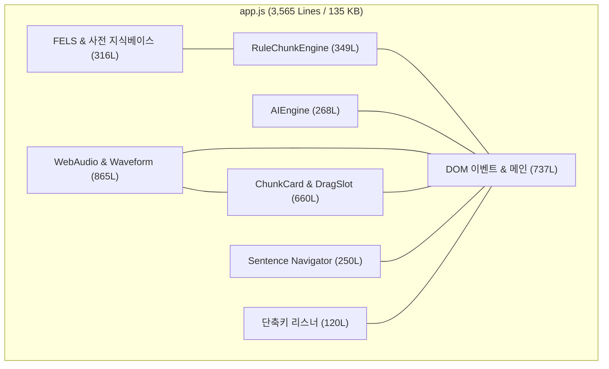
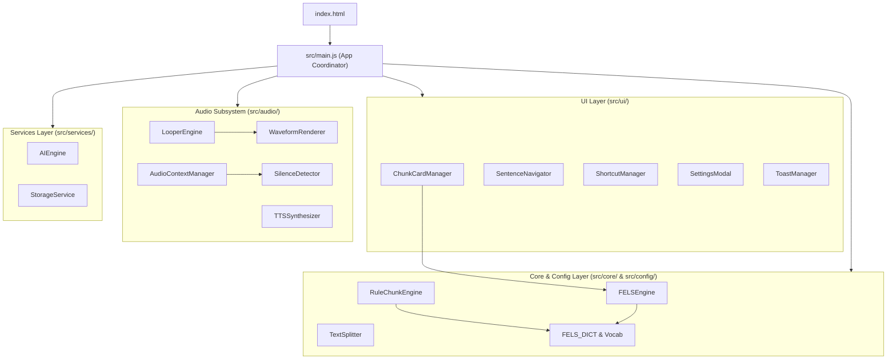

# 🏛️ ChunkLingo 패키지(디렉토리) 모듈화 및 재구조화 계획서
**Document ID:** `PLN-RESTRUCT-20261011_1411`  
**작성 일시:** 2026-10-11 14:11 (KST)  
**대상 프로젝트:** ChunkLingo (3-Mode Multi-Input AI Chunk & FELS Weak-Form Listening Trainer)  
**작성 목적:** 단일 거대 파일(`app.js` 3,565행, `styles.css` 1,984행)로 비대해진 프로젝트 구조를 도메인 주도 계층형 패키지 구조로 분리하여 유지보수성, 확장성, 테스트 용이성을 극대화하기 위한 상세 아키텍처 재구조화 가이드.

---

## 1. 🔍 현행 구조 정밀 진단 및 문제점 분석

### 1.1 현재 파일 구조 현황
```text
c:\Users\user\Desktop\local\09ce_tool_new\
├── .agents/                      # 에이전트 룰 및 스킬 정의
├── AGENTS.md                     # 실행 정책 문서
├── index.html                    # 462행 (25.7 KB) - 전체 마크업 단일 파일
├── styles.css                    # 1,984행 (41.0 KB) - 모든 UI/컴포넌트 단일 CSS
└── app.js                        # 3,565행 (135.5 KB) - 단일 거대 모놀리식 스크립트
```

### 1.2 `app.js` 내부 책임 과밀 분석 (Lines 1 ~ 3,565)
현재 `app.js`는 하나의 IIFE 즉시실행함수 안에 **6개 이상의 서로 다른 핵심 도메인**이 강하게 결합(Tight Coupling)되어 있습니다.

| 도메인 영역 | 담당 라인 범위 | 현재 포함된 주요 기능 및 데이터 | 문제점 |
| :--- | :--- | :--- | :--- |
| **FELS & 언어 지식베이스** | L1 ~ L316 (316행) | 7대 약형 카테고리(`FELS_CATEGORIES`), 기능어 목록, 대명사/전치사/동사/숙어 사전 매핑 테이블 | 순수 정적 데이터임에도 UI/오디오 코드와 혼재되어 파일 크기 증가 및 스크롤 피로 유발 |
| **스마트 규칙 청킹 엔진** | L317 ~ L665 (349행) | `RuleChunkEngine`: 어휘 형태소 분석, 구/절 분할 규칙, 직독직해 한국어 규칙 생성기 | 독립적인 단위 테스트가 불가능하며, 규칙 확장 시 메인 UI 로직 영향 |
| **AI 연동 서비스** | L666 ~ L933 (268행) | `AIEngine`: Google Gemini 1.5 멀티모달 STT & 구조화 프롬프트, OpenAI Whisper/GPT-4o 연동, LocalStorage 키 관리 | API 호출 로직과 에러 핸들링이 단일 파일에 갇혀 있어 모의(Mock) 테스트나 프로바이더 추가 어려움 |
| **오디오 & 파형 엔진** | L1420 ~ L2285 (865행) | Web Audio API 디코딩, 무음 구간 RMS 감지, 대칭형 Canvas 네온 파형 드로잉, 문장 단위 파형 줌, A-B 루퍼 엔진, 음성 합성(TTS) | 가장 무겁고 복잡한 연산 로직으로, UI 조작 로직과 얽혀 있어 프레임 드랍 및 상태 추적 난이도 높음 |
| **청크 카드 & 약형 퀴즈 UI** | L2900 ~ L3560 (660행) | 3D 플립 카드 렌더링, '\|\|' 드래그 앤 드롭 재청킹 슬롯, FELS 빈칸 채점 및 정답 오버레이, 카드 너비 자동 고정 동기화 | DOM 조작 코드의 비중이 과도하게 높고 상태 변경 시 리렌더링 복잡도 증가 |
| **단축키 & 네비게이션 제어** | L1096 ~ L1420, L2550 ~ L2800 (600여행) | 단축키(`Space`, `[`, `]`, `\`, `R`, `←`, `→`, `S`, `T`), 하단 문장 네비게이터, 테마/모달/토스트 관리 | 전역 이벤트 리스너와 컨트롤러가 산재되어 중복 및 이벤트 누수 위험 |

---

## 2. 🎯 재구조화 목표 및 아키텍처 원칙

1. **관심사의 완벽한 분리 (Separation of Concerns)**
   - 순수 언어 규칙/데이터(Data), 비즈니스 로직(Core Engine), 오디오 처리(Audio), 외부 통신(Services), 사용자 인터페이스(UI)를 명확히 분리합니다.
2. **무설치 네이티브 브라우저 호환 (Vanilla ES Modules)**
   - 번들러(Vite, Webpack)나 무거운 빌드 과정 없이도 브라우저 표준 `<script type="module">`을 통해 100% 즉시 구동될 수 있도록 설계합니다.
   - 필요 시 추후 Vite, TypeScript, 번들러 도입이 즉시 가능한 표준 패키지 구조를 준수합니다.
3. **단위 테스트 및 독립 검증 가능 구조**
   - 브라우저 DOM 없이도 `node` 환경에서 `RuleChunkEngine`이나 `FELS Engine`의 단위 테스트(`node test.js`)를 단독 실행할 수 있는 구조를 확립합니다.
4. **점진적 무장애 마이그레이션 (Zero-Downtime Migration)**
   - 기존의 모든 인터페이스(9개 단축키, A-B 루퍼, 문장 파형 연동, 3D 플립 등)의 동작을 100% 동일하게 보존합니다.

---

## 3. 📂 제안 패키지(디렉토리) 디테일 구조

```text
c:\Users\user\Desktop\local\09ce_tool_new\
├── index.html                           # 진입 HTML (<script type="module" src="./src/main.js">)
├── src/                                 # 자바스크립트 모듈 루트
│   ├── main.js                          # 최상위 애플리케이션 진입점 & 이벤트 허브
│   │
│   ├── config/                          # 환경 설정 및 상수 정의
│   │   ├── constants.js                 # 기본 반복 횟수(3회), 쉐도잉 대기(0.5s), 캔버스 파형 바 개수(360) 등
│   │   └── fels-dict.js                 # 7대 약형 기능어 목록 및 사전 매핑 테이블
│   │
│   ├── core/                            # 순수 비즈니스 로직 & 분석 엔진 (No DOM)
│   │   ├── fels-engine.js               # FELS 약형 분석 및 토큰 추출 엔진
│   │   ├── rule-chunk-engine.js         # 스마트 로컬 직독직해 & 청킹 휴리스틱 엔진
│   │   └── text-splitter.js             # 문장 자동 분할 및 약어 보존 분할 엔진
│   │
│   ├── services/                        # 외부 통신 및 브라우저 스토리지
│   │   ├── ai-service.js                # Gemini 1.5 & OpenAI Whisper/GPT-4o API 클라이언트
│   │   └── storage-service.js           # API 키, 커스텀 프롬프트, 테마 설정 LocalStorage 추상화
│   │
│   ├── audio/                           # 오디오 & 파형 시각화 전용 서브시스템
│   │   ├── audio-context.js             # Web Audio API Context 초기화 및 PCM 디코더
│   │   ├── silence-detector.js          # PCM RMS 에너지 분석 기반 문장 무음 구간 자동 감지
│   │   ├── waveform-renderer.js         # Canvas 대칭형 네온 민트 문장 단위 파형 렌더러
│   │   ├── looper-engine.js             # A-B 루퍼 구간 반복 & 0.5초 쉐도잉 대기 엔진
│   │   └── tts-synthesizer.js           # Web Speech API & 무음 WAV 연동 음성 합성기
│   │
│   └── ui/                              # DOM 조작 & 렌더링 컴포넌트
│       ├── chunk-card-manager.js        # 3D 플립 카드, '||' 드래그 재청킹, FELS 빈칸 채점
│       ├── sentence-navigator.js        # 하단 도킹 문장 네비게이터 바 & 칩 트랙 렌더러
│       ├── shortcut-manager.js          # 9대 글로벌 단축키(Space, [, ], \, R, ←, →, S, T) 매니저
│       ├── settings-modal.js            # AI 환경 설정 팝업 제어
│       └── toast-manager.js             # 사용자 알림 토스트 팝업 제어
│
├── styles/                              # 스타일시트 모듈화
│   ├── main.css                         # 전체 스타일 통합 진입점 (@import 기반)
│   ├── base/
│   │   ├── reset.css                    # 브라우저 리셋 & 폰트 로드
│   │   └── variables.css                # 테마 색상, 폰트, 반응형 토큰, 글래스모피즘
│   ├── components/
│   │   ├── header.css                   # 상단 헤더 & 테마/설정 버튼
│   │   ├── audio-player.css             # 파형 캔버스, 시간 HUD, 단축키 안내 바
│   │   ├── chunk-cards.css              # 3행 스택 카드, 3D 플립, FELS 인풋, '||' 구분자
│   │   ├── sentence-navigator.css       # 화면 하단 도킹 문장 네비게이터 & 칩
│   │   ├── input-section.css            # 3모드 탭, 텍스트에어리어, 오디오 업로드 존
│   │   └── modal-toast.css              # API 설정 모달, 토스트 팝업
│   └── layout/
│       └── layout.css                   # 메인 컨테이너 그리드 & 섹션 배치
│
└── docs/                                # 프로젝트 설계 & 구현 문서 격리 보관
    ├── architecture/
    └── refactoring/
        └── package_restructuring_plan_20261011_1411.md
```

---

## 4. 🧩 모듈별 책임 및 인터페이스 설계

### 4.1 Core 모듈군 (`src/core/`)
| 파일 경로 | 주요 Export 항목 | 세부 책임 |
| :--- | :--- | :--- |
| `src/config/fels-dict.js` | `FELS_CATEGORIES`, `PRONOUNS`, `PREPOSITIONS`, `BE_VERBS` 등 | 약형 기능어 세트 및 번역 지식베이스 상수 |
| `src/core/fels-engine.js` | `getFelsInfo(token)` | 주어진 영단어가 7대 약형 기능어에 해당하는지 판별하고 라벨/원형 반환 |
| `src/core/rule-chunk-engine.js` | `class RuleChunkEngine` | 문장을 문법 규칙에 따라 청크 단위로 나누고 직독직해 한국어 생성 |
| `src/core/text-splitter.js` | `splitIntoSentences(text)` | 마침표, 물음표, 느낌표 기준 분할하되 Dr., U.S., 소수점 예외 보존 |

### 4.2 Services 모듈군 (`src/services/`)
| 파일 경로 | 주요 Export 항목 | 세부 책임 |
| :--- | :--- | :--- |
| `src/services/storage-service.js` | `StorageService` | `localStorage` 기반 API 키, 프로바이더 설정, 테마 상태의 안전한 읽기/쓰기 |
| `src/services/ai-service.js` | `class AIEngine` | Gemini 1.5 Multimodal 및 OpenAI Whisper/GPT-4o 통신 및 구조화 데이터 변환 |

### 4.3 Audio 모듈군 (`src/audio/`)
| 파일 경로 | 주요 Export 항목 | 세부 책임 |
| :--- | :--- | :--- |
| `src/audio/audio-context.js` | `AudioContextManager` | `AudioContext` 싱글톤 관리, 음원 디코딩, WAV Blob 변환 |
| `src/audio/silence-detector.js` | `detectSentenceBoundaries(buffer, sentences)` | PCM 데이터 에너지 분석으로 무음 구간을 찾아 문장별 시작/끝 시간 산출 |
| `src/audio/waveform-renderer.js` | `WaveformRenderer` | Canvas 상에 대칭형 네온 민트 파형, 문장 줌 파형, 플레이헤드, 루프 박스 렌더링 |
| `src/audio/looper-engine.js` | `LooperEngine` | A-B 루프 시작점/끝점 관리, 반복 횟수 카운팅, 0.5초 쉐도잉 대기 타이머 제어 |
| `src/audio/tts-synthesizer.js` | `TTSSynthesizer` | 스크립트 전용 입력 시 Web Speech API 음성 재생 및 무음 WAV 동기화 |

### 4.4 UI 모듈군 (`src/ui/`)
| 파일 경로 | 주요 Export 항목 | 세부 책임 |
| :--- | :--- | :--- |
| `src/ui/chunk-card-manager.js` | `ChunkCardManager` | 3D 플립 카드 DOM 생성, '\|\|' 드래그 앤 드롭 재청킹 처리, 카드 너비 균일 고정 |
| `src/ui/sentence-navigator.js` | `SentenceNavigator` | 화면 최하단 도킹 패널 관리, 칩 가로 스크롤 트랙 렌더링, 이전/다음 문장 버튼 이벤트 |
| `src/ui/shortcut-manager.js` | `ShortcutManager` | 9대 전역 단축키 이벤트 리스너 중앙 관리, 한/영 IME 호환, 인풋 필드 타이핑 충돌 방지 |
| `src/ui/settings-modal.js` | `SettingsModal` | API 설정 팝업 노출, 프로바이더 선택, 키 저장/초기화 |
| `src/ui/toast-manager.js` | `showToast(msg)` | 하단 플로팅 토스트 메시지 큐 및 애니메이션 |

### 4.5 최상위 오케스트레이터 (`src/main.js`)
- `AppController`가 각 도메인 모듈 인스턴스를 주입받아 이벤트 버스를 통해 상호 작용하도록 조율(Orchestration)만 담당 (기존 3,565행 ➔ 약 **200행 내외**로 대폭 축소).

---

## 5. 🔄 아키텍처 다이어그램 (Before & After)

### 5.1 Before (모놀리식 단일 파일 스파게티 구조)


### 5.2 After (도메인 주도 계층형 모듈 아키텍처)


---

## 6. 🚀 단계별 점진적 리팩토링 로드맵 (7-Phase Roadmap)

### Phase 1: 기반 디렉토리 생성 및 순수 데이터 분리
- **작업 내용:**
  - `src/config/`, `src/core/`, `src/services/`, `src/audio/`, `src/ui/`, `styles/` 폴더 트리 생성.
  - `FELS_CATEGORIES`, 사전 매핑 데이터를 `src/config/fels-dict.js`로 추출.
  - `splitIntoSentences()`를 `src/core/text-splitter.js`로 추출.
- **검증 기준:** `node -c src/config/fels-dict.js`, 기존 기능 정상 작동 유지.

### Phase 2: 순수 비즈니스 엔진 모듈화 (Core)
- **작업 내용:**
  - `getFelsInfo()` ➔ `src/core/fels-engine.js`
  - `RuleChunkEngine` ➔ `src/core/rule-chunk-engine.js`
- **검증 기준:** 독립 노드 스크립트로 임의 영문 문장 청킹 및 직독직해 유닛 테스트 실행 성공.

### Phase 3: 외부 통신 및 스토리지 분리 (Services)
- **작업 내용:**
  - `AIEngine` (Gemini & OpenAI) ➔ `src/services/ai-service.js`
  - LocalStorage 및 세팅 입출력 ➔ `src/services/storage-service.js`
- **검증 기준:** API 키 저장/복원 및 AI 번역 호출 모듈 테스트.

### Phase 4: 오디오 및 캔버스 파형 엔진 모듈화 (Audio)
- **작업 내용:**
  - Web Audio 디코딩, PCM 무음 분석, Canvas 렌더링, A-B Looper 로직을 `src/audio/` 하위 모듈로 격리.
- **검증 기준:** MP3 업로드 시 파형 렌더링, 문장 줌 파형, A-B 루프 0.5s 무음 대기 재생 정상 작동 확인.

### Phase 5: UI 컴포넌트 및 단축키 관리자 분리 (UI)
- **작업 내용:**
  - 3D 플립 카드 & '\|\|' 드래그 앤 드롭 ➔ `src/ui/chunk-card-manager.js`
  - 하단 문장 네비게이터 ➔ `src/ui/sentence-navigator.js`
  - 9대 단축키 통합 관리자 ➔ `src/ui/shortcut-manager.js`
- **검증 기준:** 단축키 9종(Space, [, ], \, R, ←, →, S, T) 동작 및 '\|\|' 이동 정상 확인.

### Phase 6: 스타일시트 모듈화 (Styles)
- **작업 내용:**
  - `styles.css` (1,984행)를 변수(`variables.css`), 컴포넌트별(`audio-player.css`, `chunk-cards.css`, `sentence-navigator.css`)로 분할 후 `styles/main.css`에서 `@import` 통합.
- **검증 기준:** 화면 레이아웃 깨짐 없이 기존과 100% 동일한 비주얼 렌더링.

### Phase 7: 통합 조율 및 최종 검증
- **작업 내용:**
  - `index.html`에서 `<script type="module" src="./src/main.js"></script>`로 변경.
  - 전체 시나리오 통합 테스트(3가지 모드, 문장 자동 분류, 드래그 청킹, 단축키 전원).
  - 정적 문법 검증 및 레거시 파일 정리.

---

## 7. ⚠️ 리스크 관리 및 브라우저 호환성 대책

1. **로컬 파일(`file://`) 프로토콜 CORS 제약 대응**
   - 브라우저의 기본 보안 정책상 `file://` 경로에서 ES Modules(`import`)을 직접 열면 CORS 제한이 발생할 수 있습니다.
   - **대책 1:** 현대 로컬 웹 개발 표준에 맞추어 `npx serve .` 또는 VS Code Live Server 등 경량 로컬 서버 구동 가이드 제공.
   - **대책 2:** 단일 번들 파일 배포가 필요한 경우, 롤업/ESBuild 기반의 무설정 1초 빌드 스크립트(`npm run build`) 병행 구성 옵션 마련.

2. **상태 동기화 단방향 데이터 흐름 유지**
   - 오디오 재생 위치가 변할 때 `LooperEngine` ➔ `WaveformRenderer` ➔ `SentenceNavigator`로 이벤트가 안전하게 전파되도록 커스텀 이벤트(`EventTarget` 또는 간단한 Pub/Sub 패턴) 도입.

3. **작업 안정성을 위한 롤백 전략**
   - 리팩토링 진행 전 기존 `app.js`와 `styles.css`는 백업 보존하고, 단계별로 모듈을 이전하여 언제든지 즉시 이전 상태로 복구할 수 있는 안정망 구축.

---

## 8. 📋 요약 및 향후 액션 플랜

본 계획서는 파일 길이가 기하급수적으로 늘어난 단일 파일 구조(`app.js`, `styles.css`)의 한계를 극복하고, 향후 기능 추가(음성 녹음 비교, 모바일 터치 제스처, 학습 통계 대시보드 등)에도 흔들림 없는 고품질 모듈형 코드베이스로 전환하기 위한 완전한 청사진입니다.

- **승인 대기:** 본 계획서 검토 후 사용자가 `/apply` 명령어를 전달하면, **Phase 1부터 순차적으로 무장애 모듈 분할 작업**을 착수합니다.
