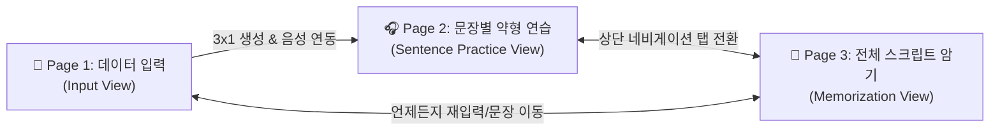
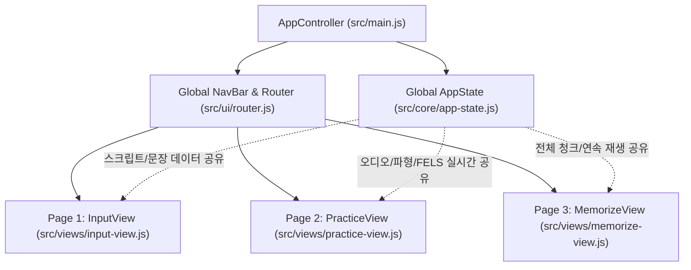

# 🏛️ CE Tool 3페이지 전환 및 패키지 재구조화 계획서
**Document ID:** `PLN-RESTRUCT-3PAGE-20261011_1417`  
**작성 일시:** 2026-10-11 14:17 (KST)  
**대상 프로젝트:** CE Tool (3-Page Multi-Input AI Chunk & FELS Weak-Form Listening Trainer)  
**작성 목적:** 단일 페이지(`Single Page`)에 집중되어 있던 UI와 기능(3,565행 단일 스크립트)을 **3개의 명확한 전용 페이지(입력 ➔ 문장별 약형 연습 ➔ 전체 스크립트 암기)**로 분할하고, 도메인 주도 계층형 패키지 구조로 재설계하기 위한 종합 아키텍처 개편 계획서.

---

## 1. 🌟 3페이지 구조 개편 개요

기존 하나의 페이지에 수직으로 나열되어 있던 인터페이스를 학습자의 인지 흐름(데이터 입력 ➔ 집중 청취/약형 훈련 ➔ 전체 문맥 암기 및 낭독)에 최적화된 **3개 전용 페이지**로 재구성합니다.



### 3개 페이지별 핵심 역할 및 배치 사양
| 페이지 번호 | 페이지 명칭 | 핵심 기능 및 사용자 인터랙션 | 레이아웃 수직 배치 규칙 |
| :--- | :--- | :--- | :--- |
| **Page 1** | **데이터 입력 페이지**<br>*(Input Page)* | • 3가지 입력 모드 탭 (음성+스크립트 / 음성만 / 스크립트만)<br>• MP3 파일 드래그 앤 드롭 및 스크립트 붙여넣기<br>• 복수 문장 프리셋 칩 선택<br>• AI API 환경설정(Gemini / OpenAI) 모달<br>• `[3x1 해석 및 FELS 생성]` 원클릭 실행 | • 상단: 헤더 & 서비스 안내<br>• 중앙: 3모드 세그먼트 & 데이터 입력창<br>• 하단: 실행 버튼 & 프리셋 칩 |
| **Page 2** | **문장 단위 약형드랩 연습 페이지**<br>*(Sentence Practice Page)* | • 문장별 1:1 집중 훈련 모드<br>• 7대 약형 기능어 빈칸 딕테이션 & 정답 채점<br>• 앞면(영어/FELS) ⇄ 뒷면(직독직해) 3D 플립 카드<br>• 마우스 드래그 '\|\|' 청크 단위 자유 수정<br>• 문장 단위 줌 파형 및 A-B Looper (0.5초 무음 쉐도잉)<br>• 9대 전역 단축키(`Space`, `[`, `]`, `\`, `R`, `←`, `→`, `S`, `T`) | **[엄격 배치 순서]**<br>① **[위]** 약형드랩 기반 청크 학습 카드 (`#rowChunks`)<br>② **[중간]** 우리말 자연 해석 (`#rowNatural`)<br>③ **[아래]** 문장 단위 음성 파형 패널 (`#audioPlayerSection`)<br>④ **[화면 맨 밑단]** 문장 자동 분류 네비게이터 (`#sentenceNavigator`) |
| **Page 3** | **전체 스크립트 암기 페이지**<br>*(Full Script Memorization Page)* | • 전체 스크립트를 한 화면에서 청크 카드 그리드로 전개<br>• 문맥 기반 청크 연계 암기 및 낭독 훈련<br>• 암기 3단계 모드: ① 전체 보기, ② 영/한 블라인드, ③ 빈칸 가리기<br>• 전체 음성 연속 재생(Full Playback) & 문장별 하이라이트 동기화<br>• 일괄 3D 플립(Flip All) 토글 지원 | • 상단: 암기 모드 컨트롤 바 & 전체 연속 재생기<br>• 중앙: 전체 스크립트 문장별 청크 카드 캔버스<br>• 하단: 암기 달성률 통계 인디케이터 |

---

## 2. 🏗️ 3페이지 라우팅 및 상태(State) 보존 아키텍처

### 2.1 라우팅 방식 선정: SPA View Switcher (단일 페이지 애플리케이션 뷰 전환)
- **선정 이유**: 브라우저의 `AudioContext`와 디코딩된 PCM 음원 메모리(`audioBuffer`), 현재 오디오 재생 객체(`HTMLAudioElement`)는 전통적인 HTML 이동(`page1.html` ➔ `page2.html`) 시 브라우저 새로고침으로 인해 **모두 소멸**됩니다.
- 따라서 **상단 글로벌 탭 바 + URL Hash (`#input`, `#practice`, `#memorize`) 기반의 SPA 뷰 전환 아키텍처**를 적용하여, **오디오 재생 상태와 디코딩된 데이터가 끊김 없이 3개 페이지 간에 100% 보존**되도록 설계합니다.



---

## 3. 📂 제안 패키지(디렉토리) 상세 구조

3개 페이지 분할에 맞추어 `src/views/` 계층을 신설하고, 컴포넌트와 비즈니스 로직을 명확하게 모듈화합니다.

```text
c:\Users\user\Desktop\local\09ce_tool_new\
├── index.html                           # SPA 셸 마크업 (상단 탭 네비게이션 + 3개 뷰 컨테이너)
│
├── src/                                 # 자바스크립트 모듈 루트 (ES Modules)
│   ├── main.js                          # 앱 진입점 및 뷰 라우팅 조율기 (~150행)
│   │
│   ├── config/                          # 정적 환경 설정 및 어휘 사전
│   │   ├── constants.js                 # 기본 3회 반복, 0.5초 쉐도잉 딜레이, 360 파형 바 수
│   │   └── fels-dict.js                 # 7대 약형 기능어 목록 & 어휘 사전 지식베이스 (316행)
│   │
│   ├── core/                            # 순수 비즈니스 로직 & 상태 관리 (No DOM)
│   │   ├── app-state.js                 # 전역 상태 관리 (입력 텍스트, 문장 목록, 활성 인덱스, 오디오 버퍼)
│   │   ├── fels-engine.js               # FELS 기능어 판별 및 빈칸 분석 엔진
│   │   ├── rule-chunk-engine.js         # 스마트 로컬 청킹 & 직독직해 생성기 (349행)
│   │   └── text-splitter.js             # 약어 보존 문장 자동 분할 엔진
│   │
│   ├── services/                        # 외부 통신 & 로컬 스토리지
│   │   ├── ai-service.js                # Gemini 1.5 & OpenAI Whisper/GPT-4o API 통신
│   │   └── storage-service.js           # API 키, 커스텀 지침, 테마 LocalStorage 제어
│   │
│   ├── audio/                           # 오디오 & 파형 시각화 전용 서브시스템
│   │   ├── audio-context.js             # Web Audio API 컨텍스트 싱글톤 & PCM 디코딩
│   │   ├── silence-detector.js          # PCM RMS 에너지 분석 문장 무음 구간 자동 감지
│   │   ├── waveform-renderer.js         # Canvas 대칭형 네온 민트 문장 단위 줌 파형 렌더러
│   │   ├── looper-engine.js             # A-B 루퍼 구간 반복 & 0.5초 쉐도잉 대기 타이머
│   │   └── tts-synthesizer.js           # 스크립트 전용 음성 합성 & 무음 WAV 동기화
│   │
│   ├── ui/                              # 공유 UI 컴포넌트 & 제어기
│   │   ├── router.js                    # 3개 페이지 탭 전환 및 URL Hash 제어기
│   │   ├── shortcut-manager.js          # 9대 전역 단축키 (Space, [, ], \, R, ←, →, S, T) 관리자
│   │   ├── settings-modal.js            # AI API 환경 설정 팝업
│   │   └── toast-manager.js             # 플로팅 알림 토스트 팝업
│   │
│   └── views/                           # 3대 전용 페이지 뷰 컴포넌트
│       ├── input-view.js                # [Page 1] 데이터 입력 페이지 (3모드 탭, 업로드 존, 프리셋)
│       ├── practice-view.js             # [Page 2] 문장 약형 연습 (위: 청크 카드 ⇄ 아래: 파형 캔버스)
│       └── memorize-view.js             # [Page 3] 전체 스크립트 암기 (전체 청크 그리드, 암기 3단계)
│
├── styles/                              # 스타일시트 모듈화
│   ├── main.css                         # 전체 스타일 통합 진입점 (@import)
│   ├── base/
│   │   ├── reset.css                    # 브라우저 리셋 & 폰트 선언
│   │   └── variables.css                # 색상 토큰, 글래스모피즘 변수, 다크/라이트 테마
│   ├── layout/
│   │   ├── layout.css                   # 공통 레이아웃 컨테이너
│   │   └── nav-tabs.css                 # 상단 3페이지 네비게이션 탭 바 스타일
│   ├── components/
│   │   ├── audio-player.css             # 파형 캔버스, 시간 HUD, 단축키 안내 바
│   │   ├── chunk-cards.css              # 3D 플립 카드, FELS 인풋, '||' 드래그 슬롯
│   │   ├── sentence-navigator.css       # 화면 최하단 도킹 문장 네비게이터 & 칩
│   │   └── modal-toast.css              # 설정 모달, 알림 토스트
│   └── views/
│       ├── input-view.css               # Page 1 전용 스타일
│       ├── practice-view.css            # Page 2 전용 스타일 (상단 카드, 하단 파형)
│       └── memorize-view.css            # Page 3 전용 스타일 (전체 청크 그리드, 블라인드 마스크)
│
└── docs/                                # 아키텍처 및 구현 문서 보관소
    └── refactoring/
        └── package_restructuring_plan_20261011_1417.md
```

---

## 4. 📄 3대 페이지별 세부 컴포넌트 명세

### 4.1 Page 1: 데이터 입력 페이지 (`src/views/input-view.js`)
- **담당 컴포넌트**:
  - `ModeTabsComponent`: `both` (음성+스크립트), `audio` (음성만 STT), `text` (스크립트만) 세그먼트 전환
  - `AudioDropArea`: MP3 오디오 파일 드래그 앤 드롭 및 파일 업로드
  - `ScriptTextArea`: 영문 스크립트 텍스트 입력 및 글자 수 카운터
  - `PresetChips`: 3개 문장 자동 분류 예시 등 원클릭 데이터 입력 칩
  - `ActionButtons`: `[3x1 해석 및 FELS 생성]` 버튼
- **전환 이벤트**:
  - 변환 성공 시 `AppState`에 문장 데이터와 오디오를 채운 후 자동으로 **Page 2 (약형 연습)**로 부드럽게 화면 전환.

### 4.2 Page 2: 문장 단위 약형드랩 연습 페이지 (`src/views/practice-view.js`)
- **담당 컴포넌트 및 수직 배치**:
  1. **[상단] 청크 학습 카드 패널 (`#rowChunks`)**:
     - 3D 플립 카드: 앞면(FELS 약형 딕테이션 빈칸) ⇄ 뒷면(직독직해 한국어 청크)
     - `||` 드래그 앤 드롭 슬롯: 단어 사이 구분자를 마우스로 이동하여 청크 재조정
     - 상단 툴바: 정답 채점, 원문 보기(S), 다시 풀기, 일괄 뒤집기
  2. **[중단] 우리말 해석 패널 (`#rowNatural`)**:
     - 자연스러운 전체 문장 한국어 번역 (기본 숨김, `T` 키로 토글)
  3. **[하단] 문장 단위 오디오 파형 패널 (`#audioPlayerSection`)**:
     - 100% 가로 너비 기준 문장 줌 파형 렌더러
     - 마우스 드래그 A-B 루퍼 & 원클릭 타임코드 Seek
     - 0.5초 무음 대기 간격 쉐도잉 엔진
     - 단축키 안내 바 (`Space`, `[`, `]`, `\`, `R`, `←`, `→`, `S`, `T`)
  4. **[화면 맨 밑단] 문장 자동 분류 네비게이터 (`#sentenceNavigator`)**:
     - 이전 문장(←), 다음 문장(→), 문장 진행율(1/3), 자동 다음 문장 토글, 문장 칩 트랙

### 4.3 Page 3: 전체 스크립트 암기 페이지 (`src/views/memorize-view.js`)
- **담당 컴포넌트**:
  - `MemorizeControlBar`:
    - 암기 모드 선택: `전체 보기` | `영어만 보기` | `한국어만 보기` | `청크 가리기(Cloze)`
    - 전체 연속 재생 버튼: `[▶ 전체 스크립트 낭독 재생]`
    - 일괄 카드 플립 토글: `[🔄 전체 카드 뒤집기]`
  - `FullScriptCanvas`:
    - 스크립트 내 모든 문장(`S1`, `S2`, `S3`...)이 순서대로 세로 전개
    - 각 문장 행마다 해당 문장의 청크 카드들이 가로로 정렬
    - 현재 재생 중인 문장은 부드러운 네온 민트 보더로 실시간 하이라이트
  - `ChunkMemorizeCard`:
    - 개별 클릭 시 블라인드 해제/가리기 토글 지원으로 자기주도 암기 테스트 가능

---

## 5. 🔄 3페이지 전환 인터페이스 설계

### 5.1 상단 공통 네비게이션 헤더 (`index.html`)
```html
<header class="app-header">
  <div class="brand">
    <div class="logo-icon">CL</div>
    <div class="brand-text">
      <h1>Chunk<span class="gradient-text">Lingo</span></h1>
    </div>
  </div>

  <!-- 3-Page Navigation Tabs -->
  <nav class="page-nav-tabs" role="tablist">
    <button class="nav-tab-btn active" data-page="input">
      <span class="tab-step">1</span>
      <span class="tab-label">데이터 입력</span>
    </button>
    <button class="nav-tab-btn" data-page="practice">
      <span class="tab-step">2</span>
      <span class="tab-label">문장 약형 연습</span>
    </button>
    <button class="nav-tab-btn" data-page="memorize">
      <span class="tab-step">3</span>
      <span class="tab-label">전체 스크립트 암기</span>
    </button>
  </nav>

  <div class="header-actions">
    <button id="btnSettings" class="icon-btn" title="AI API 설정">⚙️</button>
    <button id="btnThemeToggle" class="icon-btn" title="테마 전환">🌓</button>
  </div>
</header>
```

### 5.2 라우터 동작 원리 (`src/ui/router.js`)
```javascript
export class AppRouter {
  constructor(views) {
    this.views = views; // { input: InputView, practice: PracticeView, memorize: MemorizeView }
    this.currentPage = 'input';
  }

  navigateTo(pageId) {
    if (!this.views[pageId]) return;
    this.currentPage = pageId;

    // 1. 네비게이션 탭 액티브 상태 변경
    document.querySelectorAll('.nav-tab-btn').forEach(btn => {
      btn.classList.toggle('active', btn.getAttribute('data-page') === pageId);
    });

    // 2. 뷰 컨테이너 토글
    Object.keys(this.views).forEach(key => {
      const container = document.getElementById(`view-${key}`);
      if (container) {
        container.classList.toggle('hidden', key !== pageId);
      }
    });

    // 3. 페이지 전환 시 뷰 활성화 훅 호출 (파형 리사이즈, 암기 캔버스 동기화 등)
    this.views[pageId].onActivated();
    window.location.hash = pageId;
  }
}
```

---

## 6. 🚀 7단계 구현 및 마이그레이션 로드맵

```mermaid
gantt
    title 3페이지 아키텍처 점진적 마이그레이션 로드맵
    dateFormat  X
    axisFormat %d단계

    section Phase 1~3
    1단계: 패키지 트리 및 전역 상태(AppState) 구축     :p1, 0, 1
    2단계: Core(FELS, Rule, Splitter) & Config 분리   :p2, 1, 2
    3단계: Services(AI API, Storage) 모듈화          :p3, 2, 3

    section Phase 4~5
    4단계: Audio 서브시스템(WebAudio, Waveform, Looper):p4, 3, 4
    5단계: 3대 뷰 컴포넌트 분리(Input, Practice, Memorize):p5, 4, 5

    section Phase 6~7
    6단계: 스타일시트(CSS) 모듈화 & 3페이지 뷰 스타일  :p6, 5, 6
    7단계: 통합 연동 검증 (단축키 9종, 3페이지 전환)  :p7, 6, 7
```

### 단계별 실행 계획 상세
1. **Phase 1: 기반 패키지 생성 & `AppState` 구축**
   - `src/` 하위 폴더 생성 (`config/`, `core/`, `services/`, `audio/`, `ui/`, `views/`).
   - 3개 페이지가 공유할 `AppState` 싱글톤 정의 (`scriptText`, `sentenceList`, `activeSentenceIndex`, `audioBuffer`).
2. **Phase 2: Core & Config 분리**
   - 7대 약형 카테고리 및 어휘 사전 ➔ `src/config/fels-dict.js`
   - `RuleChunkEngine` ➔ `src/core/rule-chunk-engine.js`
   - `TextSplitter` ➔ `src/core/text-splitter.js`
3. **Phase 3: Services 모듈화**
   - Gemini/OpenAI API 호출 ➔ `src/services/ai-service.js`
   - LocalStorage 설정 입출력 ➔ `src/services/storage-service.js`
4. **Phase 4: Audio 서브시스템 모듈화**
   - Web Audio Context, 무음 구간 분석, Canvas 파형 렌더러, A-B Looper 엔진 분리.
5. **Phase 5: 3대 페이지 뷰 컴포넌트 구현**
   - `Page 1`: `src/views/input-view.js` (데이터 입력)
   - `Page 2`: `src/views/practice-view.js` (**위: 청크 카드 / 아래: 파형 패널**)
   - `Page 3`: `src/views/memorize-view.js` (전체 스크립트 청크 암기)
   - `Router`: `src/ui/router.js` 탭 전환기 구현
6. **Phase 6: 스타일시트 모듈화 (`styles/`)**
   - `main.css`를 중심으로 `variables.css`, `nav-tabs.css`, 각 뷰 전용 CSS 분할.
7. **Phase 7: 통합 검증 및 단축키 무장애 점검**
   - 9대 단축키(`Space`, `[`, `]`, `\`, `R`, `←`, `→`, `S`, `T`)가 Page 2와 Page 3에서 정확히 작동하는지 전수 검증.
   - `node -c` 구문 검사 및 브라우저 호환성 검증.

---

## 7. ⚠️ 리스크 대응 및 호환성 보장 정책

1. **오디오 재생 연속성 보장**
   - Page 2(문장 연습)에서 파형을 듣다가 Page 3(전체 암기)로 탭을 변경해도 Web Audio Buffer가 재로드 없이 즉시 이어서 재생될 수 있도록 `AppState`에 `AudioContext`와 `AudioBuffer`를 중앙 보관합니다.
2. **단축키 충돌 방지**
   - Page 1(입력 페이지)에서는 타이핑이 주 목적이므로 전역 단축키가 텍스트 입력을 방해하지 않도록 철저히 비활성화됩니다.
   - Page 2(연습 페이지)에 진입했을 때만 9개 핫키가 활성화됩니다.
3. **무장애 롤백 대책**
   - 기존 `app.js`와 `styles.css` 원본은 `legacy_backup/` 폴더에 그대로 보존하여, 문제 발생 시 즉각 롤백할 수 있는 안정망을 유지합니다.

---

## 8. 📌 승인 및 실행 안내

- 본 계획서는 사용자의 요구사항(3개 페이지 분할, Page 2 상하 배치 순서 지정, Page 3 전체 암기 뷰 신설)을 완벽히 수렴하여 작성되었습니다.
- 본 계획서 검토 후 **`/apply`** 명령어를 입력해 주시면 **Phase 1부터 순차적으로 무장애 코드 리팩토링 및 3페이지 분할 작업**을 즉시 착수합니다.
